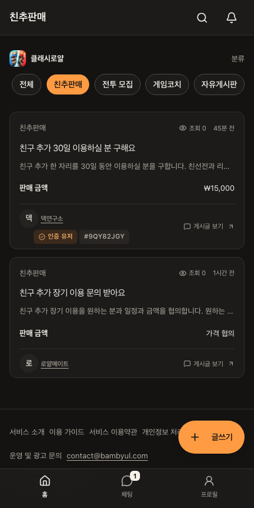
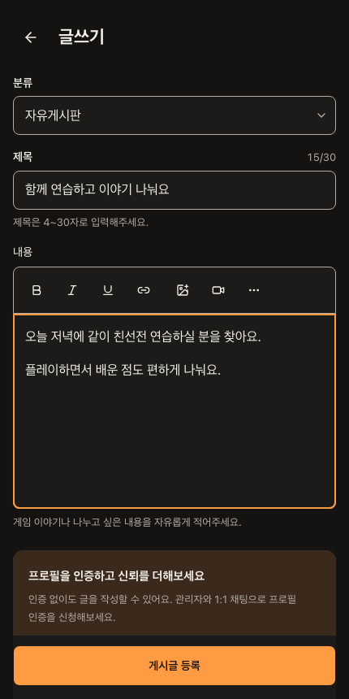
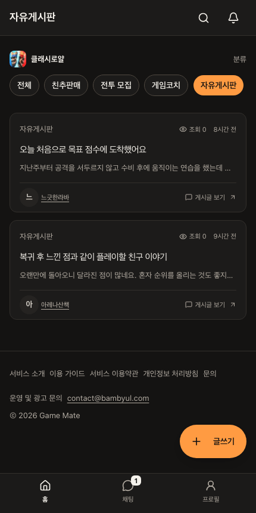
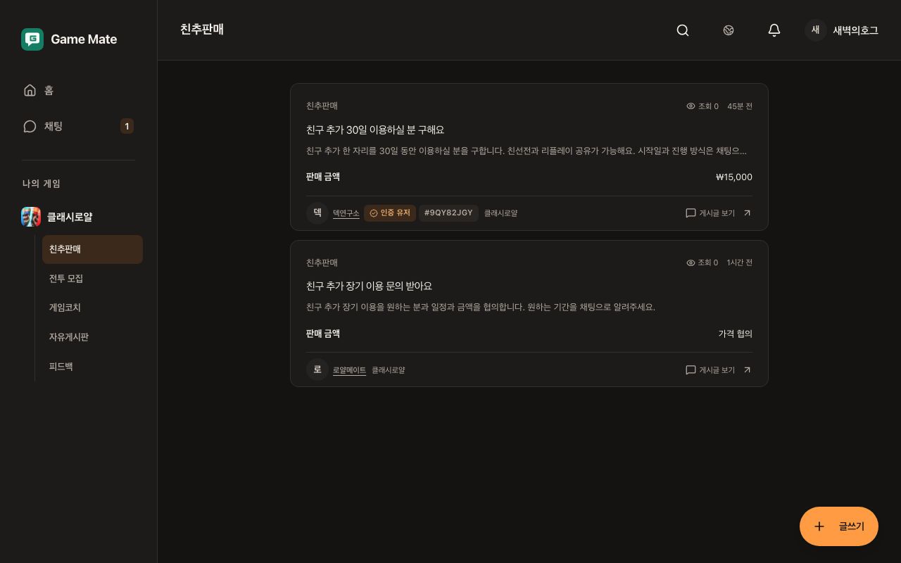
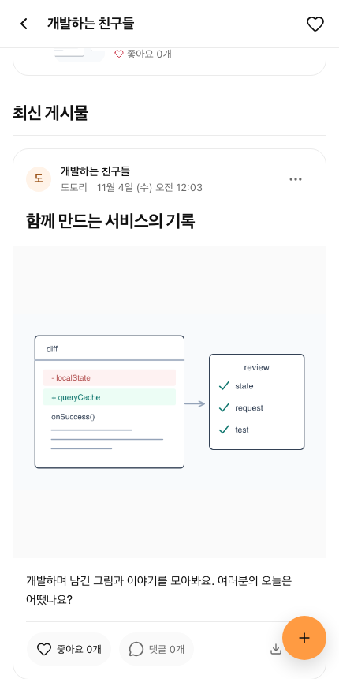
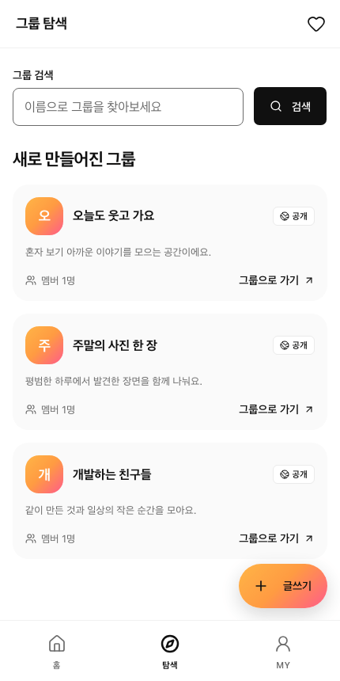
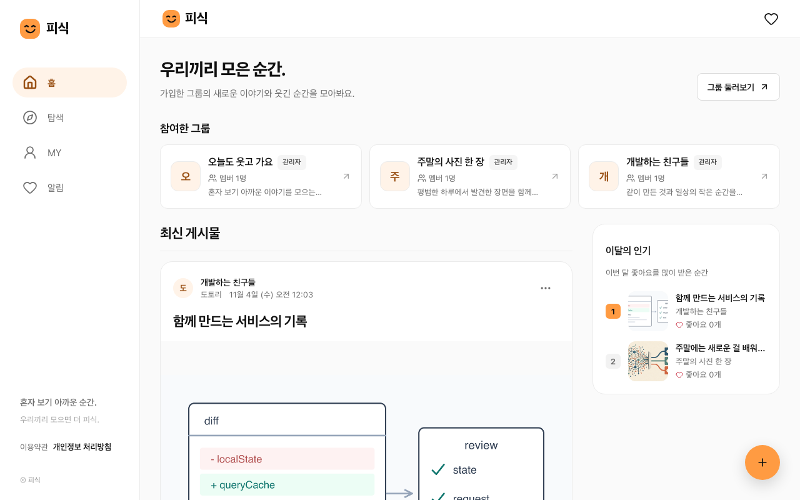
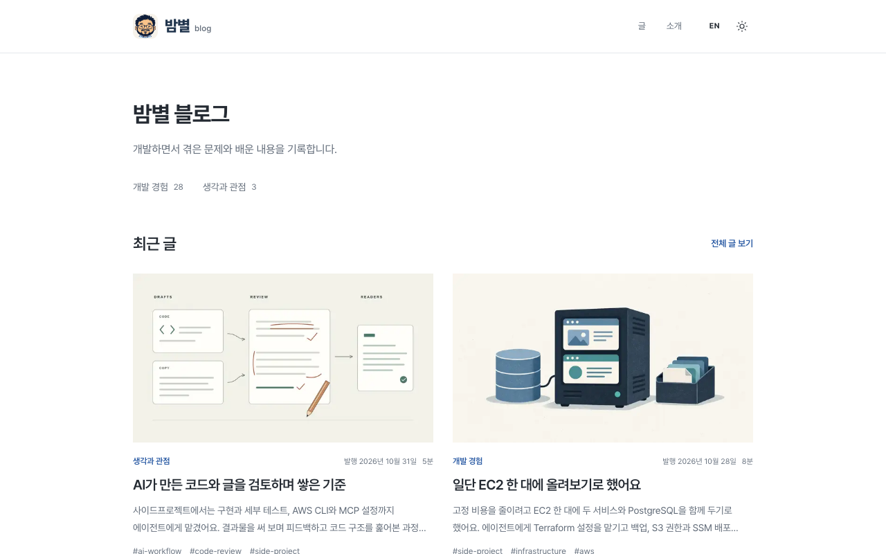

# 사이드 프로젝트

글로벌 게임 서비스 **Game Mate**와 사진 커뮤니티 **피식**을 개발하는 모노레포입니다. 각 서비스의 웹, API, 모바일 앱을 함께 관리하고, 만들면서 겪은 문제와 기술 선택은 블로그에 기록합니다.

## 서비스

Game Mate와 피식 화면의 계정과 게시물은 예시 데이터입니다.

### Game Mate

한국어, 영어, 일본어로 함께 게임할 사람을 찾고 플레이에 대한 조언과 코칭을 구하는 글로벌 게임 서비스입니다. 게시글로 상대를 찾고, 1:1 채팅으로 대화를 이어 갑니다.

- 피드백, 친추판매, 전투 모집, 게임코치, 자유게시판
- 게시글 검색과 유형, 답변 상태 필터
- 이미지와 동영상 첨부, 대화 이력이 남는 1:1 채팅
- 공개 프로필, 팔로우와 알림

[서비스 열기](https://game.bambyul.com/ko) | [기능 안내](projects/game-feedback/docs/features.md) | [실행과 개발](projects/game-feedback/README.md)

|                                                       게시판                                                        |                                                  글쓰기                                                   |
| :-----------------------------------------------------------------------------------------------------------------: | :-------------------------------------------------------------------------------------------------------: |
|  |  |

<details>
<summary>글을 작성하고 등록하는 흐름 보기 (약 10초)</summary>



</details>

<details>
<summary>데스크톱 화면 보기</summary>



</details>

### 피식

사진과 영상, 링크를 그룹 안에서 나누는 커뮤니티입니다. 그룹은 계속 이용하는 공간으로 두고, 그 안에서 별도의 사진 대회를 열어 투표하고 결과를 돌아볼 수 있습니다.

- 공개 그룹 참여와 비공개 그룹 가입 승인
- 사진, 영상, 링크 게시물과 댓글, 좋아요
- 가입한 그룹의 통합 최신 피드와 이달의 인기 게시물
- 그룹 대회, 투표와 종료 후 순위

[서비스 열기](https://contest.bambyul.com) | [서비스 소개](https://contest.bambyul.com/about) | [기능 안내](projects/photo-contest/docs/features.md) | [실행과 개발](projects/photo-contest/README.md)

|                                                  그룹 탐색                                                   |                                                  그룹 게시물                                                   |
| :----------------------------------------------------------------------------------------------------------: | :------------------------------------------------------------------------------------------------------------: |
|  |  |

<details>
<summary>그룹을 둘러보고 댓글을 남기는 흐름 보기 (약 7초)</summary>



</details>

<details>
<summary>데스크톱 화면 보기</summary>



</details>

두 서비스의 모바일 앱은 Expo WebView로 웹 화면을 공유합니다. 웹 배포와 앱스토어 배포는 각각 진행합니다.

### 개발 블로그

서비스를 만들면서 겪은 문제와 선택한 이유를 한국어와 영어로 정리합니다. 글은 Git 기반 MDX로 관리하고, 별도 API나 데이터베이스 없이 Vercel에 배포합니다.

[글 읽기](https://blog.bambyul.com/ko) | [English](https://blog.bambyul.com/en) | [콘텐츠 작성과 개발](projects/blog/README.md)



## 빠른 시작

저장소 루트에서 Node.js 24와 Yarn 4.17.0을 준비합니다.

```sh
nvm use
npm install --global @yarnpkg/cli-dist@4.17.0 --force
yarn install --immutable
```

각 프로젝트 README에 따라 환경 파일과 DB를 준비한 뒤, 세 서비스를 함께 실행합니다.

```sh
yarn dev
```

Game Mate와 피식의 API·웹, 블로그 웹을 함께 시작합니다. 서비스 하나만 실행할 때는 같은 형식의 workspace 명령을 사용합니다.

| 프로젝트  | 개발 서버 실행                           | 로컬 주소                                     | 환경 준비                                               |
| --------- | ---------------------------------------- | --------------------------------------------- | ------------------------------------------------------- |
| Game Mate | `yarn workspace @side/game-feedback dev` | [localhost:3300/ko](http://localhost:3300/ko) | [설정 안내](projects/game-feedback/README.md#빠른-시작) |
| 피식      | `yarn workspace @side/photo-contest dev` | [localhost:3200](http://localhost:3200)       | [설정 안내](projects/photo-contest/README.md#빠른-시작) |
| 블로그    | `yarn workspace @side/blog dev`          | [localhost:3100/ko](http://localhost:3100/ko) | [설정 안내](projects/blog/README.md#빠른-시작)          |

전체 실행은 일반 개발 모드를 사용합니다. Game Mate의 테스트 인증과 예시 콘텐츠가 필요하면 별도로 `yarn workspace @side/game-feedback dev:test`를 실행합니다. 피식은 개발 DB와 마이그레이션 준비가 필요하며, 두 서비스의 미디어 업로드는 로컬에서도 실제 AWS S3를 사용합니다. Ctrl+C 또는 서비스 프로세스의 종료는 전체 실행이 시작한 서버를 함께 정리하며, DB 중지는 각 프로젝트 명령을 따릅니다.

| 프로젝트      | 웹              | API  | 개발 / 테스트 DB |
| ------------- | --------------- | ---- | ---------------- |
| game-feedback | 3300            | 4300 | 55442 / 55444    |
| photo-contest | 3200            | 4200 | 55432 / 55434    |
| blog          | 3100 (E2E 3101) | 없음 | 없음             |

프로젝트별로 환경변수, DB, 생성된 Prisma client와 스토리지 경로를 분리합니다. 테스트에는 실행 중인 개발 서버와 DB를 재사용하지 않습니다.

## 저장소 구조

```text
projects/
  game-feedback/        # Game Mate: Next.js, NestJS REST, Expo
  photo-contest/        # 피식: Next.js, NestJS GraphQL, Expo
  blog/                 # 개발 기록: Next.js, 다국어 MDX
packages/
  design-system/        # 공통 UI, 토큰, Storybook
  config/               # ESLint, TypeScript, tsc7
  toolkit/              # 공통 푸시 전송과 migration/Sentry 검사
scripts/                # Git hook, worktree, 저장소 검사
deploy/shared-instance/ # 두 서비스의 EC2, 프록시, DB, Terraform
```

프로젝트의 앱은 `projects/<name>/apps/*`, 해당 프로젝트 안에서 공유하는 코드는 `projects/<name>/packages/*`에 둡니다. 여러 프로젝트가 실제로 함께 쓰는 코드만 루트 `packages/*`로 올립니다.

## 검증과 배포

각 프로젝트 README에 있는 검사 명령을 사용합니다. 공통 도구와 테스트 격리 규칙은 [개발 가이드](docs/development.md), 작업 지침은 [AGENTS.md](AGENTS.md)에 있습니다.

1. `origin/develop`에서 기능 브랜치를 만들고 변경한 앱의 검사를 실행합니다.
2. PR을 merge commit으로 `develop`에 반영합니다.
3. 검증한 `develop`을 `main`에 병합합니다. 운영 배포 기준은 `main`입니다.
4. Game Mate와 피식은 Services Actions에서 검사하고 서비스별로 배포하며, 블로그는 Vercel Git 연동으로 배포합니다. 운영 반영 여부는 해당 배포 결과에서 확인합니다.

두 서비스는 EC2의 Caddy와 PostgreSQL 18을 공유하되 DB role과 네트워크를 분리합니다. 미디어는 비공개 S3의 서비스별 prefix에, DB 백업은 별도 버킷에 저장합니다. 배포와 복구 절차는 [EC2 운영 안내](deploy/shared-instance/README.md)를 따릅니다.

## 관련 문서

- [공통 설치, 포맷, hook, worktree와 검사](docs/development.md)
- [코드 감사 후속 과제와 완료 기준](docs/code-quality-followups.md)
- [Game Mate 제품 범위](projects/game-feedback/docs/product.md)
- [피식 기능과 이용 흐름](projects/photo-contest/docs/features.md)
- [공유 UI와 디자인 시스템](packages/design-system/README.md), [UI 디자인 기준](.agents/skills/ui-design/SKILL.md)
- [블로그 콘텐츠 작성](projects/blog/README.md#콘텐츠-작성)과 [배포 설정](projects/blog/docs/deployment.md)
- [EC2 운영과 복구](deploy/shared-instance/README.md), [Terraform](deploy/shared-instance/terraform/README.md)

현재 실행과 배포 방법은 각 README와 배포 가이드에, 이전 결정과 검증 결과는 프로젝트의 `docs/implementation.md`에 남깁니다.

밤별(Bambyul)은 제 이름의 ‘별 진’과 ‘하늘 건’에서 따온 이름입니다.
