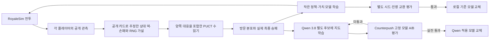

# 로컬 자가대국·수읽기·새 버전 평가

2026-11-17. 실전 덱은 바바리안 통, 진화 용광로, 고블린 오두막, 무덤, 히어로 얼음 마법사, 진화 기사, 독, 해골 병사다. 자가대국은 이 덱과 11개 상대 덱을 사용한다.

## 실행 구조



로컬 수읽기는 가상 전투마다 27B 모델을 부르는 대신 현재 v4의 약 150만 파라미터 정책·가치 모델이 담당한다. **Qwen3.8-27B**의 마지막 MLP LoRA 후보는 별도로 전술 자료를 배운다. controller 3 후보는 텍스트 전술 v3 자료(각 행동과 12초 대기를 비교한 라벨)를 받고, 공개 전투 그림과 PUCT 방문 분포 자료(`clash-arena-qwen-search-v1`)는 수동 `arena study`의 격리 후보만 학습한다. 같은 상주 Qwen 본체에 후보 어댑터만 연결하며, 학습 후 적용 어댑터와 버전이 유지됐는지 검사한다. controller 4 실시간 플레이는 게시된 작은 정책을 사용한다.

AlphaZero의 자가대국·탐색 정책 학습·승패 가치 학습·별도 평가를 참고했다. 동시 행동과 숨은 손패를 다루는 제한된 정보 집합 탐색이며 같은 알고리즘이나 실력을 주장하지 않는다. 시작 가치에는 타워 체력·왕관 차이의 작은 보조값이 있다. 건물을 남기거나 카드를 많이 쓰는 것 자체에는 보상을 주지 않는다.

## 전투·관측 계약

- Apple Silicon용 RoyaleSim **0.1.53**을 고정 설치한다. 실행 코드 커밋, 배포 파일 SHA256, 수치표·보정표 해시, 덱·형태·레벨을 묶은 `rulesID`를 경기·모델·평가에 저장한다. 오래된 기본 표 대신 **2026-11-03, 클라이언트 160635007** 표를 명시적으로 선택한다.
- 전투 코어가 이동, 사거리, 공격 주기, 표적 선택, 투사체, 생성 유닛, 영역 주문, 타워, 현재 진화와 히어로 능력을 계산한다. 일반·진화·히어로 형태를 별도로 지정한다.
- 상대 손패·다음 카드·큐·정확한 엔진 잔량·능력 상태를 모델에 넘기지 않는다. 엘릭서는 같은 재생 시간, 공개 지출, 10 상한의 소실량으로 추정한다. 타깃 내부 ID와 터널 목적지도 제거한다.
- 경기마다 양쪽 입력 지연과 카드 레벨을 정한다. 엔진은 받아들인 명령을 그 쪽의 지연(엔진이 실제 클라이언트에서 잰 값은 21~22틱)이 지난 뒤 실행하고, 손패와 엘릭서도 그때 바뀐다. 실행 전 명령은 둔 쪽만 알고, 상대에게는 실행된 틱에 공개 기록으로 남는다. 지연과 레벨은 공개된 설정으로 보는 한계가 남아 있다. 유닛 이동은 최근 단계마다 남긴 공개 위치로 계산한다.
- 덱 8장, 손패 4장, 대기 큐 4장의 FIFO에서 공개 카드 순서와 내 실제 손패·다음 카드에 맞는 초기 패만 남긴다. `clash-arena-observation-v2`는 상대 덱 이름/8장 목록도 숨긴다. 공개된 상대 카드가 모두 들어 있고 FIFO와 모순되지 않는 덱을 풀에서 추정한다. 공개 전 상대 덱을 바꿔도 관측·특징·탐색은 같아야 한다. 이는 12개 덱을 사전 후보로 사용하는 추정이며 임의의 모든 덱을 복원하는 기능은 아니다.
- 공개 플레이를 각 가설에서 그 쪽 지연만큼 앞당겨 다시 실행하고, 내가 둔 아직 실행 전인 명령도 함께 다시 둔다. **현재 보이는 유닛·위치·체력·주문·타워와 일치하는 가설만** 탐색한다. 후보 덱을 한 번씩 시도한 뒤 반복하며, 최대 `max(16, 후보 덱 수 × 2)`회에도 재현되지 않으면 오류로 남긴다. 전술 교사도 같은 검사를 쓴다. 로컬 관측에 대한 검사이며 화면 인식 오차까지 해결했다는 뜻은 아니다.
- FIFO 가설은 실행 때뿐 아니라 **입력을 수락한 시점에도 그 카드가 손에 있었는지** 검사한다. 같은 틱에서는 입력을 먼저 검사하고 지연된 카드 실행/뽑기를 뒤에 반영한다. 이전 카드가 1틱 뒤에 뽑아줄 카드를 미리 낸 가설은 최종 손패가 맞아도 제외한다. 내 아직 실행 전인 카드 예약도 검사한다.
- 공개 지출은 네이티브 `step_commands_run()`의 실제 실행 영수증으로 확정한다. 수락됐지만 영웅 사망 등으로 실행이 취소된 스킬은 지출·공개 사용으로 남기지 않는다. 전술 비교 분기는 전투 저장본뿐 아니라 지연·대기 입력·초기 손패 등 장부도 같은 루트에서 복사한다.
- 재구성에 실패하면 `arena/reconstruction-failures/`에 공개 관측·후보 덱·마지막으로 재구성한 공개 전장을 남기고 멈춘다. 실제 상대 손패·숨은 RNG 저장본을 기록하거나 가설에 주입하지 않는다. 오류 뒤에도 종료 신호 처리기와 실행 잠금을 복원한다.
- 양쪽 대응을 함께 적용하는 탐색이다. 첫 수는 판단 간격(1초), 이후 수는 2초 단위다. 기본 16회·6수다. 실제 도달 깊이·시간·가설 수·방문 분포를 저장한다. 제한된 손패/RNG 표본과 배치 후보를 쓰며 모든 미래를 완전 탐색하지 않는다.
- 손패·비용·합법 배치를 네이티브 엔진이 검사한다. 후보 지점은 카드 이름이 아니라 카드 카탈로그의 배치 유형으로 정한다. 근접·원거리 유닛과 굴림 주문은 양 라인·킹타워 뒤와 위협 앞(원거리는 3타일, 그 밖은 1타일 앞), 건물은 중앙 수비 지점, 범위 주문은 위협·상대 유닛·상대 타워, 소환 주문(무덤)은 상대 타워 주변 6곳, 타워 주문(고블린 통)은 상대 타워와 그 앞, 어디든 놓는 카드(광부·드릴)는 위협과 상대 타워 앞뒤다. 판단 시점의 후보는 이 규칙 지점에 더해 우리 진영의 모든 칸(유닛·건물·굴림 주문)과 필드의 두 칸마다·상대 유닛 위치(주문)를 엔진이 합법으로 판정한 것 전부다. 정책이 모두에 순위를 매기고, 탐색은 그중 16개(학습 중에는 Gumbel top-k 표본, 대기 포함)를 펼친다. 탐색 안쪽 수는 규칙 지점만 쓴다. 실전 후보(`src/core/fast/candidates.ts`)도 같은 지점과 격자를 쓰며, 화면에서 알 수 있는 금지 구역(타워·영웅 버튼·내 오두막)을 뺀다.
- 파이어 스피릿·창 고블린은 새 카드 지출로 잡지 않는다. 능력은 2 엘릭서 행동이며 FIFO·진화를 움직이지 않는다. 무덤은 고정 생성 순서를 코어가 재현한다.

RoyaleSim에도 충돌·일부 효과의 미검증 가정이 남아 있다. [보정 기록](https://royalegym.github.io/RoyaleGym/repos/royalesim/calibration/)의 증거 수준을 존중한다. **최신 수치, 코어 동작, 실제 게임/Counterpush와의 일치는 각각 별도 검증이다.** 현재 여덟 장의 기본 계약을 확인했으며 전체 카드·모든 챔피언·히어로의 실전 일치를 보장하지 않는다.

## 학습·채택

덱과 경기 설정은 `contracts/arena.json`이 정한다. 기존 4개 덱에 드릴·로켓병, 진화 로켓병 호그, 페카 브리지, 라바 벌룬, 로얄 자이언트, 석궁, 자이언트 무덤, 골렘 덱을 추가해 12개 덱·61종을 사용한다. 실전 덱 카드는 전투 카탈로그 0~7번을 유지한다. 기본 대전 분포는 미러전 50%, 실전 덱과 다른 풀 덱 25%(두 진영 교대), 풀 안의 임의 조합 25%다. 경기 ID로 재현하며 카드 추가와 실제 표본·숙련은 구분한다. 판단 20틱·탐색 40틱, 입력 지연 18~26틱, 레벨 ±1과 인식 오류 설정은 유지한다.

Qwen 텍스트 전술 자료는 혼합 덱 경기에서도 **내가 현재 8장 덱을 사용하는 쪽의 행동 전 장면**을 받는다. 드릴·로켓병 수비가 미러전 필터에서 사라지지 않는다. 상대가 다른 덱을 사용하는 쪽의 손패·행동을 현재 8장 어휘로 바꾸지 않는다. decision-v3에 없는 상대 이름은 불명으로 남으며 모든 상대 카드가 구별되는 것은 아니다. 그림과 PUCT 방문 분포를 쓰는 별도 시각 자료는 현재 미러전만 내보낸다.

`rulesID`는 카드 표·엔진뿐 아니라 공개 정보 형식, 상대 덱 추정 방식, 입력 지연·레벨 변동·인식 오류·판단/탐색 간격과 평가 묶음도 포함한다. 이 설정이 바뀌면 새 리그에서 직전 챔피언의 같은 형식 가중치를 이어 쓰고, 이전 경기·평가·전술 재생은 섞지 않는다. 이전 리그의 미검증 후보를 챔피언으로 승격하거나 기록을 변환하지 않는다.

현재 정책과 고정한 과거 정책을 상대로 양쪽 모두 플레이한다. 자기 자신과 과거 상대를 섞고 자주 지는 상대의 선택 비중을 높인다. 경기 중 모델은 바뀌지 않는다. 끝나지 않은 경기를 무승부로 바꾸지 않으며 명령이 거절된 경기에서는 학습하지 않는다.

입력은 실전 화면과 같은 decision-v3 판단 문맥이다. 내 손패·다음 카드·엘릭서, 상대 엘릭서 범위, 손에 없다고 아는 상대 카드(돌아오기까지 남은 사용 횟수), 양쪽 유닛과 효과의 9×16 격자, 능력 준비, 경기 시각이며 타워 체력은 학습 표본의 절반에서 가린다(`contracts/fast-policy.json`). 격자 칸에는 오브젝트 특징과 함께 화면에서 본 체력(카탈로그의 레벨 11 최대 체력 대비)·이동 방향을 더하고, 칸마다 다 더한 뒤 한 번에 잘라 순서와 무관하게 한다. 카드는 카드 카탈로그의 특징 18개(엘릭서, 유닛·건물·주문, 소환 수, 체력, DPS, 사거리, 속도, 공중·지상·건물 대상, 비행, 범위, 주문 피해, 지속 시간, 소환, 둔화·정지)로, 필드의 유닛과 지속 주문은 같은 성격의 특징 16개로 격자 칸에 더한다(`contracts/card-catalogue.json`). 손패는 네 칸 특징의 합을 4로 나눈 묶음, 행동은 대기·능력·카드 표시와 비용·위치·진화 여부에 카드 특징과 위치 관계 13개(가장 가까운 적과 위협까지의 거리·방향, 범위 안 적의 수와 체력, 주변 아군, 양쪽 타워까지의 거리, 라인, 상대 진영)를 붙인다. 학습 입력은 화면 인식 오류(유닛 누락 8%, 이름 모름 10%, 위치 ±0.5타일, 이동 확인 70%, 체력 확인 30%, 효과 누락 15%)를 넣은 사본으로 만들고, 탐색과 정답은 실제 경기를 쓴다. 탐색하지 않은 후보 16개는 정답 0으로 함께 배워 격자의 나쁜 지점이 실전에서 뽑히지 않게 한다. 카드마다 칸을 두지 않으므로 덱이 바뀌어도 가중치 모양이 같고, 처음 보는 상대 카드도 체력·사거리 같은 성격으로 읽는다. 정책은 탐색 방문 분포를, 가치는 엔진이 확정한 최종 결과(`승리=+1/패배=-1/무승부=0`) 0.5와 경기 종료 시 양쪽 타워 체력 손실 차이 0.5를 섞은 값을 배운다. 그래서 0:3 패배와 2:3 패배가 다른 신호가 된다. 학습은 경기마다 따로 쓴 가벼운 리플레이(`*.replay.json.gz`, 상태는 0이 아닌 칸만 저장)에서 최근 256판, 최대 16,384표본을 다시 쓰며 다른 `rulesID`는 섞지 않는다. 새 번호로 모델을 저장하고 가중치 해시를 검사한다.

로컬 평가는 학습과 다른 시드로 같은 환경을 두 번 실행하고 진영을 교환한다. 탐색 없이 정책만으로 입력 지연 22틱·레벨 11에서 둔다. 절반은 실전 덱 미러전이고 절반은 실전 덱과 다른 풀 덱의 조합이며, 한 쌍에서 두 정책이 두 진영·덱을 각각 맡는다. 정식 평가는 모든 상대 덱을 포함하도록 현재 최소 **22쌍/44판**이다. 전체 점수 55% 이상·신뢰 구간 하한 50% 초과·단측 부호 검정과 더불어 미러전과 혼합 덱 묶음 각각 50% 이상을 요구한다. 반복 평가에는 유의수준 지출을 적용한다. 통과한 후보만 `champion`이 되며 `learner`는 따로 보존한다. 새 챔피언은 학습하지 않는 무작위·수비형 규칙 봇과도 비교해 `benchmarks/`에 점수·Wilson 구간을 남긴다. 사람이나 실제 클래시로얄 상대의 실력은 아니다.

Qwen에는 결과나 숨은 패를 입력하지 않는다. 수동 `arena study`는 공개된 **행동 전** 그림과 합법 후보만 주고 탐색 분포로 지도학습한다. Counterpush 자동 루프는 controller가 같은 전술 v3 자료만 받는다. 이를 on-policy PPO로 표시하지 않는다. 낮은 학습률, KL 제한, 손실 감소와 실제 가중치 변경을 검사한다. Counterpush 반복 실행은 **별도 후보에서 실전 PPO·상대 행동 모방·자가대국 수읽기 학습**을 진행한다. 적용 모델의 `current.json`은 학습 때문에 바뀌지 않는다.

Counterpush A/B는 고정한 기준·후보를 한 브라우저에서 AB/BA 순서로 대전시킨다. 평가 중 PPO·상대 모방·수읽기 학습을 금지하며 `current.json`은 바뀌지 않는다. 행동 선택 분포는 실전과 같은 categorical 정책이다. 사이트에서 시작 패/상대 RNG를 지정할 수 없으므로 같은 시드의 쌍이라고 보고하지 않는다. 같은 계정의 여러 탭 동시 대전은 쓰지 않는다.

### 검증을 통과한 Qwen만 자동 채택

2026-11-16부터 `counterpush start`는 다음 과정을 반복한다.

1. 적용 모델을 고정하고 별도 후보를 준비한다. 기본적으로 후보 실전 학습 8판(`--training-matches`)과 새 자가대국 전술 자료 학습을 한다.
2. 후보의 특정 체크포인트를 고정하고 **최소 16쌍/32판**으로 기준 모델과 비교한다. 양쪽 모두 학습을 끄고, 별도로 새로 시작한 경기만 평가한다.
3. 새 실전 평가는 **승률**을 기준으로 한다. 승리 1·그 외 0이고 쌍 점수는 `0.5 + (후보 승리 - 기준 승리)/2`다. 평균 0.55 이상(후보 관측 승률이 최소 10%p 높음)이며 승패가 다른 쌍에 대한 단측 정확 이항 검정을 통과해야 한다. 무승부를 승리로 세지 않는다. 반복 평가는 총 0.05의 유의수준 예산을 나눠 쓴다. 판수·판정법·기준·후보를 시작 전에 함께 등록하고 변경을 거부한다. 불확실하거나 둘 다 계속 패배하면 채택하지 않는다.
4. 통과하면 Python 학습기가 **원본 경기의 두 번 일치한 왕관, 실제 사용 어댑터 해시, 평가 중 학습 금지, 중복·학습 자료 유출 부재, 평가 시도 등록, 현재 기준 모델**을 다시 검사한다. 통과 플래그만으로 교체하지 않는다.
5. 검증된 가중치와 optimizer를 새 적용 버전으로 복사한 뒤 `current.json`을 원자적으로 교체한다. 이전 버전은 보존한다. 미통과하면 기준 모델을 유지하고 후보를 더 학습한다.

적용 모델(챔피언)의 학습기는 항상 고정되어 `Learner.save`와 직접 PPO/모방 쓰기를 거부한다. 실제 정책 교체는 위 검증을 수행하는 게시 경로만 사용한다. 학습·평가용으로 후보가 게임을 플레이하는 것과 적용 모델 포인터를 교체하는 것을 구분한다. 새 버전 번호나 학습 손실 감소를 실력 향상으로 보지 않는다.

`evolution.json`이 현재 후보, 대기 중 학습 경기, 평가 파일과 채택 결과를 소유한다. PPO 후 프로세스가 종료돼도 receipt를 읽어 같은 갱신을 재적용하지 않는다. 평가를 재개할 때에는 같은 기준·후보·시도 번호와 이미 끝낸 경기를 유지한다. 게시 후 실행 기록을 쓰기 전에 종료된 경우도 이미 검증된 게시를 인식해 두 번 적용하지 않는다. `counterpush evaluate` 단독 명령은 비교 결과만 기록하고, 자동 채택은 `counterpush start`가 담당한다.

장기간 평가 예산이 작아져도 모든 미래 후보가 자동 탈락하지 않도록 필요한 최소 판수도 시작 전에 늘린다. 로컬 평가의 표본 수와 시도 예약에도 같은 원칙을 적용한다. 이미 시작한 구형 Hoeffding/무승부 0.5 평가는 원래 규칙으로 끝내며 도중에 더 유리한 검정으로 바꾸지 않는다. [정확 McNemar 검정의 이항 분포](https://www.statsmodels.org/stable/generated/statsmodels.stats.contingency_tables.mcnemar.html)와 [단측 이항 검정](https://raw.githubusercontent.com/scipy/scipy/main/scipy/stats/_binomtest.py)을 참고했으며 라이브러리를 추가 설치하지 않았다.

현재 판정은 **이 덱과 Counterpush 상대**에 대한 것이다. 실제 클래시로얄 트로피 상대나 모든 덱에서의 우위를 검증한 것으로 확대하지 않는다. 통계적 판정이며 모든 후속 경기의 승리를 보장하지 않는다.

## 명령

저장소에서 실행한다. 파일 인수는 Yarn 작업 폴더의 영향을 받지 않도록 절대 경로로 지정한다.

```sh
yarn workspace @side/clash-bot arena:setup
yarn workspace @side/clash-bot arena start --background --hours 0 --games 4 --simulations 16 --depth 8 --pairs 16 --evaluate-every 2
yarn workspace @side/clash-bot arena status
yarn workspace @side/clash-bot arena stop

# 학습 → 실전 분리 평가 → 통과한 후보만 적용을 계속 반복한다.
yarn workspace @side/clash-bot counterpush start --background --hours 0 --matches 0 --training-matches 2 --pairs 16
yarn workspace @side/clash-bot counterpush status
yarn workspace @side/clash-bot counterpush stop

# 작은 전체 흐름 확인. 2쌍으로는 채택하지 않는다.
yarn workspace @side/clash-bot arena start --generations 1 --games 2 --simulations 8 --depth 6 --pairs 2

# 완료 경기로 별도 Qwen 후보 생성. Counterpush 자동 루프는 전술 v3 자료만 자동 학습하고 이 탐색 분포 자료는 학습하지 않는다.
yarn workspace @side/clash-bot arena export --samples 8
yarn workspace @side/clash-bot arena study

# study가 출력한 candidate_checkpoint 폴더를 사용한다.
yarn workspace @side/clash-bot counterpush evaluate --candidate /absolute/path/to/candidate/checkpoints/v000067 --pairs 16 --hours 8 --background --resume
```

`counterpush start`의 기본 시간 제한은 없다. 두 실행 모두 `--hours 0`은 정지 요청까지 반복하고 양수는 최대 24시간의 실행 한도다. `--resume`은 단독 평가를 마친 뒤 자동 채택 학습 루프를 시작한다. `counterpush stop`은 현재 경기를 마치고 후보·평가 진행을 저장한다. 다시 `start`하면 같은 평가를 이어간다. 불명확한 결과·검증 오류는 기준 모델을 유지하고 실행을 중단하며 정상적인 성적 미달은 후보 학습을 계속한다. `arena stop`은 현재 게임/평가 쌍과 저장을 마치고 멈춘다. 두 실행은 독립된 상태·정지 요청·저장 위치를 가진다. Mac 절전 해제나 프로세스 자동 재시작 기능은 없다.

자료는 `.data/arena/leagues/<rulesID 앞 16자>-fast4/`의 `episodes/`, `checkpoints/`(압축 가중치와 메타데이터), `evaluations/`, `league.json`, 실전용 `champion-policy.json`, `arena policy --version <번호>`로 내보낸 `policies/`에 둔다. 실전용 JSON은 가중치 파일보다 약 6배 커서 챔피언이 바뀌거나 직접 내보낼 때만 쓴다. Qwen 입력은 `exports/`, 후보는 `qwen/candidates/` 또는 `qwen/training/`, 소비 기록은 `qwen/studies.jsonl`이다. 실전 원본은 `counterpush/runs/`, 비교 결과는 `counterpush/control/evaluations/`, 반복 실행 상태는 `counterpush/control/evolution.json`, 게시 이력은 `promotions.jsonl`이다.

## 밸런스 패치

```sh
yarn workspace @side/clash-bot arena rules
yarn workspace @side/clash-bot arena rules --stage-version 0.1.53
```

첫 명령은 공식 전투 밸런스 공지와 엔진 배포 버전을 확인한다. **Merge Tactics 공지는 제외한다.** 두 번째는 지정 버전의 출처·배포 해시를 검사하고 최신 날짜의 표를 별도 준비한다. 우리 덱 카드와 자식 유닛, 히어로·진화, 관련 투사체·효과·버프, 공통 규칙·타워 변경을 비교한다. 공개 후 24시간이 지나지 않은 배포판은 준비하지 않는다.

패치는 보통 일부 카드의 수치만 바꾸고 때로 메커니즘을 바꾼다. 준비 결과(`candidate.json`)는 바뀐 카드·유닛·효과마다 숫자만 바뀌었으면 `stats`, 항목이 생기거나 사라졌거나 문자·목록·플래그가 바뀌었으면 `mechanics`로 나눈다. 숫자만 바뀌면 엔진 고정 버전 갱신이 필요하고(`requires_engine_pin_update`), 메커니즘이 바뀌었거나 덱 카드가 표에서 빠지면 엔진 지원과 카드 계약 검사가 먼저 필요하다(`requires_engine_support_and_contract_tests`).

새 엔진/수치표를 자동 설치·활성화하지 않는다. 버전 핀과 어댑터를 갱신하고 `arena catalogue`로 카드 카탈로그를 다시 만든 뒤 카드 회귀 검사·공개 정보 검사·평가·실전 화면 일치를 확인해야 한다. 카탈로그가 고정 엔진 수치표와 다르면 `catalogue_build_test`가 실패한다. 코어의 수치 오버레이는 지원 열이 제한돼 모든 사거리·생성 규칙·새 스킬을 동적으로 바꿀 수 없다. 새 효과는 구현도 필요하다. 공지 문장에서 숫자를 추측하지 않으며 엔진 제공자의 반영 지연도 고려해야 한다.

변경된 규칙은 새 `rulesID`와 별도 리그를 사용한다. 진행 경기와 과거 승패를 새 규칙으로 다시 표시하지 않는다. 새 리그의 첫 정책은 직전에 실행한 리그(`control/active.json`)의 챔피언 가중치다. 바뀌지 않은 카드의 판단은 그대로 두고 바뀐 카드는 새 규칙의 자가대국으로 다시 맞춘다. 새 후보가 평가를 통과하기 전까지 실전은 이어받은 챔피언을 쓰며, 어느 리그의 몇 번 챔피언에서 시작했는지는 `checkpoints/v000000/metadata.json`의 `inheritedFrom`과 `arena status`에 남는다. 정책 형식(`LEAGUE_KEY`)이 다르면 이어받지 않는다. 카드 특징은 카탈로그 값으로 들어가므로 수치만 바뀐 카드는 입력값이 바뀌고, 새 유닛이나 새 카드도 카탈로그에 특징이 생길 뿐 가중치 모양은 같다. 카탈로그의 특징 목록(`cardFeatures`·`bodyFeatures`)이나 격자가 바뀔 때만 `LEAGUE_KEY`를 올리고 처음부터 학습한다. 수치 변경을 추적하는 구조는 있지만 모든 미래 패치를 즉시 자동 재현한다고 보장하지 않는다.

## 확인한 결과

- `test:arena`는 수치표·덱 형태, FIFO 가설, 정보 차단, 엘릭서 상한, 자식 생성, 고정 무덤 12마리, 진화 충전, 능력 비용·순환, 실제 gradient·재로딩, 탐색 재현, 평가·패치 분리를 검사한다.
- 첫 전체 실행은 자가대국 **2판**, 학습 **257상황/27단계**, 별도 평가 **4판**이었다. 가중치는 바뀌었지만 평가 점수는 **50%**라 기준 v0을 유지했다. 첫 두 가상 경기 실측 시간은 37.71초·9.25초(8회 탐색·6수)다. 실전 추론 지연이나 모든 게임의 처리량 보장이 아니다.
- 공개 수읽기 자료 8개로 Qwen3.8 v66에서 별도 v67 후보를 만들었다. 지도학습 손실 4.3223 → 4.2614, 최대 KL 0.00115 미만, 어댑터 해시 변경을 확인했다. 실전 v66 해시·버전은 유지됐다. **승률 향상 증거는 아니다.**
- 초기 실전 연결 확인은 고정한 두 모델의 greedy 선택으로 각 1판씩 수행했다. 기준 14회·후보 11회의 카드 입력이 확인됐고 둘 다 패배했다. 평가 후 기준 가중치는 유지됐다. 현재 categorical 평가의 충분한 표본 승률로 이 결과를 표시하지 않는다.
- 타입 검사와 Vitest 89개, Python 학습 검사 27개, 로컬 전투 검사 18개가 통과했다. 별도 전체 Qwen 통합 검사 1개는 기본 검사에서 건너뛰었고 위의 운영 모델 지도학습·재적용·실전 고정 어댑터 교환을 직접 확인했다. 추가 전투 검사에서 접근 적에 대한 오두막 자식 생성·추가 지출 부재, 독 수비 시 무덤의 타워 피해 감소를 확인했다. 오두막 비용 검사의 오래된 기대값 5를 현재 표·실전 설정과 일치하는 4로 고쳐 재실행했다.
- 초기 학습 실행에서 MLX의 예약 속성 `state`와 충돌한 이름을 수정한 뒤 학습을 다시 성공시켰다. 첫 실전 비교 명령은 상대 경로 해석 때문에 실패했으며 절대 경로로 재실행해 완료했다.
- 자동 채택 추가 후 타입 검사·Vitest **99개**, Python 학습 검사 **31개**, 로컬 전투 검사 **19개**가 통과했다. 전체 Qwen 통합 검사 1개는 기본 검사에서 건너뛰었다. 격리된 작은 어댑터와 검사 자료로 통과 시 게시·재로딩, 불충분/변조/중복/학습 중 평가 자료 거절, 보호된 적용 모델 쓰기 차단, 실패 시 유지, 학습·평가·게시 복구를 검사했다. 수만 회 평가가 누적된 조건에서도 개선 후보를 채택할 수 있는 표본 예산과 사전 등록한 검정 유지도 검사했다. 초기 타입 오류와 기존 단일 탭 오류 메시지 회귀는 수정한 뒤 재실행했다.
- 운영 Qwen에서는 **실제 후보 학습 1판 + 자가대국 자료 학습**으로 별도 후보 v72를 저장했고 적용 v68의 해시는 유지됐다. 기존 실행을 종료하는 동안 기록된 미검증 v69/v70도 삭제하지 않았으며 요청 시점 v68을 기준으로 고정했다(`qualification-cutover.json`). 실제 비교 2판의 결과를 저장한 뒤 같은 후보·평가 시도 번호로 재개한 것을 확인했다. 운영 실전에서 충분한 평가를 통과해 새 모델을 채택한 결과는 아직 없다.

참고 저장소·라이선스는 [THIRD_PARTY.md](../THIRD_PARTY.md)에 기록했다. 다른 프로젝트의 결과·속도를 이 봇의 성능으로 사용하지 않는다.

## 전술 재생의 규칙 격리

규칙이 다른 전술 재생 자료는 `replay-scope.json`의 현재 규칙별로 선별한다. 이전 규칙의 파일은 보존하고 현재 학습에 섞지 않는다. 새 범위 파일이 없으면 재생을 생략하며 다음 새 감독 자료를 등록할 때 범위를 만든다. 기존 파일을 새 형식으로 변환하거나 삭제하지 않는다.

## 전술 장면의 선택 범위

자가대국의 첫 경기·초반부터 8개 정답을 채우던 방식은 저엘릭서 장면으로 편향될 수 있다. Qwen 전술 자료는 현재 실전 덱의 카드별 사용 가능 기회, 여러 경기와 초·중·후반 상태를 고르게 선택한다. 선택에는 행동 전 손패·비용·잔량·시점만 사용하며 승패·미래 행동·교사 정답은 사용하지 않는다. 정답은 선택 후 같은 전장을 재생해 구하고, 이득이 확인되지 않는 장면은 기존 기준으로 제외한다.

이 선별은 현재 8장 덱의 전술 학습이다. 카드 카탈로그 143장 전체가 훈련된다는 뜻은 아니다. 자가대국의 덱 풀은 12개 덱·중복 제거 61종이며, 지원 카드·실제 배치·정답 표본·숙련도를 구분한다.

## 전투 환경의 재현 검사

`yarn workspace @side/clash-bot arena verify`는 현재 `rulesID`의 검사 결과를 `.data/arena/verification/<rulesID>.json`에 남긴다. 학습 시작 시에도 실행해 실패하면 대국을 시작하지 않는다.

- 풀의 모든 카드/덱 조합 96개의 배치·형태 설정과 공개 엘릭서 장부를 검사한다.
- 체력이 낮은 드릴의 자연 사망은 고블린을 남기고, 바통은 드릴을 먼저 파괴한 뒤 사망 생성 프레임의 고블린도 제거하는지 확인한다. 생성 한 틱의 존재와 살아남은 고블린을 구분한다.
- 같은 이동 중인 자이언트에 중앙 독과 뒤쪽 가장자리 독을 사용해 체류 시간에 따라 실제 남은 체력이 달라지는지 비교한다.
- 히어로 얼법 등장 유무의 해골 생존, 무덤에 독을 쓴 경우와 기다린 경우의 타워 피해를 비교한다.
- 입력은 수락됐지만 지연 시간 중 영웅이 사망해 취소된 스킬이 공개 지출로 계산되지 않는지 검사한다.

이는 엔진 내부의 통제된 재현 검사다. 실제 앱 영상과 좌표·피해·틱을 대조한 증거는 아니므로 `realClientParityVerified`는 `false`다. 밸런스 감시는 현재 8장 이름의 부분 문자열뿐 아니라 전체 카드·유닛·투사체·생성 효과·버프를 비교한다. 새 버전은 자동 설치하거나 수치를 추측해서 활성화하지 않는다.
