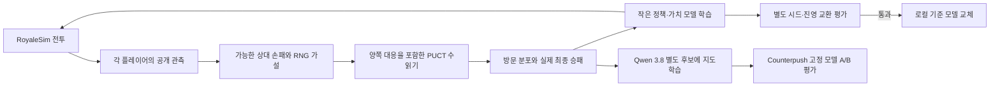

# 로컬 자가대국·수읽기·새 버전 평가

2026-11-16. 현재 양쪽 덱은 바바리안 통, 진화 용광로, 고블린 오두막, 무덤, 히어로 얼음 마법사, 진화 기사, 독, 해골 병사다.

## 실행 구조



화면을 조작하는 모델은 계속 **Qwen3.8-27B**다. 가상 전투마다 27B 모델을 실행하는 대신 약 5만 파라미터의 정책·가치 모델이 수읽기를 담당한다. 현재 Qwen의 마지막 MLP LoRA를 복제한 별도 후보가 공개 전투 그림과 수읽기 분포를 배운다. 같은 상주 Qwen 본체에 후보 어댑터만 연결하므로 27B 모델을 두 개 올리지 않는다. 학습 후 실전 어댑터와 버전이 유지됐는지 검사한다.

AlphaZero의 자가대국·탐색 정책 학습·승패 가치 학습·별도 평가를 참고했다. 동시 행동과 숨은 손패를 다루는 제한된 정보 집합 탐색이며 같은 알고리즘이나 실력을 주장하지 않는다. 시작 가치에는 타워 체력·왕관 차이의 작은 보조값이 있다. 건물을 남기거나 카드를 많이 쓰는 것 자체에는 보상을 주지 않는다.

## 전투·관측 계약

- Apple Silicon용 RoyaleSim **0.1.53**을 고정 설치한다. 실행 코드 커밋, 배포 파일 SHA256, 수치표·보정표 해시, 덱·형태·레벨을 묶은 `rulesID`를 경기·모델·평가에 저장한다. 오래된 기본 표 대신 **2026-11-03, 클라이언트 160635007** 표를 명시적으로 선택한다.
- 전투 코어가 이동, 사거리, 공격 주기, 표적 선택, 투사체, 생성 유닛, 영역 주문, 타워, 현재 진화와 히어로 능력을 계산한다. 일반·진화·히어로 형태를 별도로 지정한다.
- 상대 손패·다음 카드·큐·정확한 엔진 잔량·능력 상태를 모델에 넘기지 않는다. 엘릭서는 같은 재생 시간, 공개 지출, 10 상한의 소실량으로 추정한다. 타깃 내부 ID와 터널 목적지도 제거한다.
- 덱 8장, 손패 4장, 대기 큐 4장의 FIFO에서 공개 카드 순서와 내 실제 손패·다음 카드에 맞는 초기 패만 남긴다. 실제 엔진의 숨은 손패나 저장 파일을 탐색의 시작점으로 복제하지 않는다.
- 공개 플레이를 각 가설에서 다시 실행하고 **현재 보이는 유닛·위치·체력·주문·타워와 일치하는 가설만** 탐색한다. 16회 시도해도 재현되지 않으면 오류로 남긴다. 로컬 관측에 대한 검사이며 화면 인식 오차까지 해결했다는 뜻은 아니다.
- 양쪽 대응을 함께 적용하는 2초 단위 탐색이다. 기본 16회·6수, 장기 실행은 8수(최대 16초)다. 실제 도달 깊이·시간·가설 수·방문 분포를 저장한다. 제한된 손패/RNG 표본과 배치 후보를 쓰며 모든 미래를 완전 탐색하지 않는다.
- 손패·비용·합법 배치를 네이티브 엔진이 검사한다. 카드별 후방·중앙·전진·위협 대응·양 라인 주문 후보는 최대 26개다. 모든 타일을 직접 출력하는 자유 좌표 정책은 아니다.
- 파이어 스피릿·창 고블린은 새 카드 지출로 잡지 않는다. 능력은 2 엘릭서 행동이며 FIFO·진화를 움직이지 않는다. 무덤은 고정 생성 순서를 코어가 재현한다.

RoyaleSim에도 충돌·일부 효과의 미검증 가정이 남아 있다. [보정 기록](https://royalegym.github.io/RoyaleGym/repos/royalesim/calibration/)의 증거 수준을 존중한다. **최신 수치, 코어 동작, 실제 게임/Counterpush와의 일치는 각각 별도 검증이다.** 현재 여덟 장의 기본 계약을 확인했으며 전체 카드·모든 챔피언·히어로의 실전 일치를 보장하지 않는다.

## 학습·채택

현재 정책과 고정한 과거 정책을 상대로 양쪽 모두 플레이한다. 자기 자신과 과거 상대를 섞고 자주 지는 상대의 선택 비중을 높인다. 경기 중 모델은 바뀌지 않는다. 끝나지 않은 경기를 무승부로 바꾸지 않으며 명령이 거절된 경기에서는 학습하지 않는다.

입력은 공개 필드 격자, 내 손패·다음 카드·진화·능력, 상대 최근 사용, 엘릭서 범위와 타워다. 정책은 탐색 방문 분포를, 가치는 엔진이 확정한 최종 `승리=+1/패배=-1/무승부=0`을 배운다. 최근 완료 경기만 재사용하며 다른 `rulesID`는 섞지 않는다. 새 번호로 모델을 저장하고 가중치 해시를 검사한다.

로컬 평가는 학습과 다른 시드로 같은 환경을 두 번 실행하고 진영을 교환한다. 탐색 잡음과 학습을 끈다. 최소 **16쌍/32판**, 점수 55% 이상, 신뢰 구간 하한 50% 초과, 단측 부호 검정을 요구한다. 반복 평가에는 유의수준 지출을 적용한다. 통과한 후보만 `champion`이 되며 최신 학습 모델 `learner`는 따로 보존한다.

Qwen에는 결과나 숨은 패를 입력하지 않는다. 공개된 **행동 전** 그림과 합법 후보만 주고 탐색 분포로 지도학습한다. 이를 on-policy PPO로 표시하지 않는다. 낮은 학습률, KL 제한, 손실 감소와 실제 가중치 변경을 검사하며 실전 체크포인트는 유지한다. Counterpush 반복 실행은 경기 사이에 새 로컬 자료를 하나씩 소비해 후보를 만든다.

Counterpush A/B는 고정한 기준·후보를 한 브라우저에서 AB/BA 순서로 대전시킨다. 평가 중 PPO·상대 모방·수읽기 학습을 금지하며 `current.json`은 바뀌지 않는다. 현재 평가의 행동 선택 분포는 실전과 같은 categorical 정책이다. 사이트에서 시작 패/상대 RNG를 지정할 수 없으므로 같은 시드의 쌍이라고 보고하지 않는다. 최소 16쌍과 보수적인 Hoeffding 구간 하한을 요구하고 반복 평가의 유의수준 지출, 원본 경기·버전·해시를 보존한다. 현재 명령은 결과를 기록하며 실전 후보를 자동 배포하지 않는다. 같은 계정의 여러 탭 동시 대전은 쓰지 않는다.

## 명령

저장소에서 실행한다. 파일 인수는 Yarn 작업 폴더의 영향을 받지 않도록 절대 경로로 지정한다.

```sh
yarn workspace @side/clash-bot arena:setup
yarn workspace @side/clash-bot arena start --background --hours 8 --games 4 --simulations 16 --depth 8 --pairs 16 --evaluate-every 2
yarn workspace @side/clash-bot arena status
yarn workspace @side/clash-bot arena stop

# 작은 전체 흐름 확인. 2쌍으로는 채택하지 않는다.
yarn workspace @side/clash-bot arena start --generations 1 --games 2 --simulations 8 --depth 6 --pairs 2

# 완료 경기로 별도 Qwen 후보 생성. Counterpush 실행 중에는 자동 처리된다.
yarn workspace @side/clash-bot arena export --samples 8
yarn workspace @side/clash-bot arena study

# study가 출력한 candidate_checkpoint 폴더를 사용한다.
yarn workspace @side/clash-bot counterpush evaluate --candidate /absolute/path/to/candidate/checkpoints/v000067 --pairs 16 --hours 8 --background --resume
```

`--resume`은 평가를 모두 마친 뒤 기존 Counterpush 학습을 재개한다. 중단·실패하면 자동 재개하지 않는다. `counterpush stop`은 현재 평가에도 적용된다. `arena stop`은 현재 게임/평가 쌍과 저장을 마치고 멈춘다. 두 실행은 독립된 상태·정지 요청·저장 위치를 가진다. Mac 절전 해제나 프로세스 자동 재시작 기능은 없다.

자료는 `.data/arena/leagues/<rulesID>/`의 `episodes/`, `checkpoints/`, `evaluations/`, `league.json`에 둔다. Qwen 입력은 `exports/`, 후보는 `qwen/candidates/`, 소비 기록은 `qwen/studies.jsonl`이다. 실전 원본은 기존 `counterpush/runs/`, 비교 결과는 `counterpush/control/evaluations/`다.

## 밸런스 패치

```sh
yarn workspace @side/clash-bot arena rules
yarn workspace @side/clash-bot arena rules --stage-version 0.1.53
```

첫 명령은 공식 전투 밸런스 공지와 엔진 배포 버전을 확인한다. **Merge Tactics 공지는 제외한다.** 두 번째는 지정 버전의 출처·배포 해시를 검사하고 최신 날짜의 표를 별도 준비한다. 여덟 장과 자식 유닛, 히어로·진화, 관련 투사체·효과·버프, 공통 규칙·타워 변경을 비교한다. 공개 후 24시간이 지나지 않은 배포판은 준비하지 않는다.

새 엔진/수치표를 자동 설치·활성화하지 않는다. 버전 핀과 어댑터를 갱신하고 카드 회귀 검사·공개 정보 검사·평가·실전 화면 일치를 확인해야 한다. 코어의 수치 오버레이는 지원 열이 제한돼 모든 사거리·생성 규칙·새 스킬을 동적으로 바꿀 수 없다. 새 효과는 구현도 필요하다. 공지 문장에서 숫자를 추측하지 않으며 엔진 제공자의 반영 지연도 고려해야 한다.

변경된 규칙은 새 `rulesID`와 별도 리그를 사용한다. 진행 경기와 과거 승패를 새 규칙으로 다시 표시하지 않는다. 수치 변경을 추적하는 구조는 있지만 모든 미래 패치를 즉시 자동 재현한다고 보장하지 않는다.

## 확인한 결과

- `test:arena`는 수치표·덱 형태, FIFO 가설, 정보 차단, 엘릭서 상한, 자식 생성, 고정 무덤 12마리, 진화 충전, 능력 비용·순환, 실제 gradient·재로딩, 탐색 재현, 평가·패치 분리를 검사한다.
- 첫 전체 실행은 자가대국 **2판**, 학습 **257상황/27단계**, 별도 평가 **4판**이었다. 가중치는 바뀌었지만 평가 점수는 **50%**라 기준 v0을 유지했다. 첫 두 가상 경기 실측 시간은 37.71초·9.25초(8회 탐색·6수)다. 실전 추론 지연이나 모든 게임의 처리량 보장이 아니다.
- 공개 수읽기 자료 8개로 Qwen3.8 v66에서 별도 v67 후보를 만들었다. 지도학습 손실 4.3223 → 4.2614, 최대 KL 0.00115 미만, 어댑터 해시 변경을 확인했다. 실전 v66 해시·버전은 유지됐다. **승률 향상 증거는 아니다.**
- 초기 실전 연결 확인은 고정한 두 모델의 greedy 선택으로 각 1판씩 수행했다. 기준 14회·후보 11회의 카드 입력이 확인됐고 둘 다 패배했다. 평가 후 기준 가중치는 유지됐다. 현재 categorical 평가의 충분한 표본 승률로 이 결과를 표시하지 않는다.
- 타입 검사와 Vitest 89개, Python 학습 검사 27개, 로컬 전투 검사 18개가 통과했다. 별도 전체 Qwen 통합 검사 1개는 기본 검사에서 건너뛰었고 위의 운영 모델 지도학습·재적용·실전 고정 어댑터 교환을 직접 확인했다. 추가 전투 검사에서 접근 적에 대한 오두막 자식 생성·추가 지출 부재, 독 수비 시 무덤의 타워 피해 감소를 확인했다. 오두막 비용 검사의 오래된 기대값 5를 현재 표·실전 설정과 일치하는 4로 고쳐 재실행했다.
- 초기 학습 실행에서 MLX의 예약 속성 `state`와 충돌한 이름을 수정한 뒤 학습을 다시 성공시켰다. 첫 실전 비교 명령은 상대 경로 해석 때문에 실패했으며 절대 경로로 재실행해 완료했다.

참고 저장소·라이선스는 [THIRD_PARTY.md](../THIRD_PARTY.md)에 기록했다. 다른 프로젝트의 결과·속도를 이 봇의 성능으로 사용하지 않는다.
