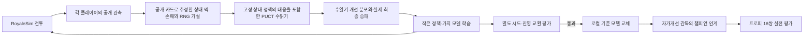

# 로컬 자가대국·수읽기·새 버전 평가

2026-11-17. 실전 덱은 바바리안 통, 진화 용광로, 고블린 오두막, 무덤, 히어로 얼음 마법사, 진화 기사, 독, 해골 병사다. 자가대국은 이 덱과 11개 상대 덱을 사용한다.

## 실행 구조



로컬 수읽기는 현재 v4의 약 150만 파라미터 정책·가치 모델이 담당한다. 리그는 챔피언이 바뀔 때 실전용 `champion-policy.json`을 게시하고, 트로피 `serve --seed`가 이 형식의 정책을 읽는다. 자가개선 감독(`loop`)은 버전 0보다 큰 새 챔피언을 트로피에 넘기고, 트로피는 같은 실전 게이트로 비교한다([README](../README.md#자가개선-감독)). 2026-11-20 전에는 이 자료로 Qwen 후보를 따로 학습했지만 그 경로는 지웠다.

AlphaZero의 자가대국·탐색 정책 학습·승패 가치 학습·별도 평가를 참고했다. 동시 행동과 숨은 손패를 다루는 제한된 정보 집합 탐색이며 같은 알고리즘이나 실력을 주장하지 않는다. 시작 가치에는 타워 체력·왕관 차이의 작은 보조값이 있다. 건물을 남기거나 카드를 많이 쓰는 것 자체에는 보상을 주지 않는다.

## 카드·위치 선택과 대기 교착

빠른 정책의 `choice` 계약은 `card_marginal_then_position_v1`이다. 예를 들어 대기가 3.3%, 카드 사용이 합계 96.7%여도 카드 확률이 수백 위치로 나뉘면 종전의 위치별 argmax는 대기를 골랐다. 지금은 대기·스킬·각 카드의 주변 확률을 비교한 뒤 선택한 카드의 위치를 고른다. 확률이나 엘릭서 규칙을 바꾸거나 카드 사용을 강제하는 보정은 아니다. 학습 중 온도도 카드와 위치에 따로 적용한다. 트로피 PPO의 categorical 확률은 이 수정으로 바꾸지 않는다.

탐색도 카드별 PUCT와 위치별 PUCT로 나누고, 루트 가지치기에서 원래 카드 확률을 보존한다. 사용 여부가 확인되지 않은 위치를 나쁜 정답으로 만들던 경로는 삭제했다. `rulesID`를 새로 만들어 이전 경기·평가·재생 자료를 섞지 않으며, 같은 차원의 이전 기준 가중치는 새 리그의 초기값으로 상속한다. 실전용 JSON은 현재 `choice` 필드가 있어야 읽는다. 과거 JSON을 자동 변환하거나 오래된 실행 자료를 덮어쓰지 않는다.

## 학습 정규화와 낮은 예산의 탐색 정답

2026-11-18 새 규칙에서 400판을 둔 리그는 정식 평가 6회 모두 미통과였다. 손실 감소와 가중치 변경만으로 개선을 보고할 수 없는 사례다. 80판/8,178개 학습 상황을 분석하고 같은 모델의 전체 후보 1,006개와 학습 후보 8개를 비교했다. 대기의 확률이 7.52%에서 77.15%로 달라졌다. 탐색은 카드별 전체 확률을 보존했지만, 학습 손실은 줄인 후보만 다시 정규화한 것이 원인이었다.

확률값만 맞추는 보정으로는 충분하지 않았다. 수집 시점의 고정 분할을 쓰면, 생략한 위치의 가중치 변화가 카드 전체 확률에 반영되지 않는다. 대표 위치 하나가 카드 전체의 기울기를 받거나, 그 위치 특징이 일정하면 다른 위치로부터 배워야 할 기울기를 아예 받지 못한다. 새 `differentiable_card_partition`은 현재 가중치로 전체 합법 후보의 log-sum-exp와 방문한 위치의 log-sum-exp를 매번 구하고 둘 모두를 미분한다. 카드 주변 확률과 방문 위치 사이의 조건부 확률을 분리하며, 미방문 위치를 0점 정답으로 만들지 않는다.

전체 행동 특징과 두 타워 관측의 전투 보정은 크기가 제한된 float32 행렬을 압축해 저장한다. 재생 창에는 압축 문자열만 유지하고 현재 학습 배치만 푼다. 형식·크기·비유한 수치·남긴 행동과의 일치를 첫 기울기 전에 확인한다. 이전 고정 보정 필드만 있는 재생 자료는 변환하지 않고 새 규칙 리그를 만든다. 모델의 실전 가중치 구조와 추론 경로는 바꾸지 않는다.

낮은 예산의 강제 방문 횟수도 좋은 행동의 정답 확률이 아니다. 잡음 전 정책을 관측한 수읽기 가치로 기울이되 KL을 0.1 이하로 제한한다. 학습 정답의 기준 정책은 실제 저장한 화면 특징에서 구한다. 타워 체력을 가린 입력은 별도 기준 정책과 정답을 사용한다. 교사의 정확한 공개 전장 prior를 잡음이 있는 학생 관측의 prior로 취급하지 않는다. `search`는 교사의 추정·방문 기록, `learning`은 두 관측의 정답 KL·추정 가치 기록이다.

정답의 KL 제한과 실제 모델 변화도 다르다. 기존 첫 16판의 대조 학습에서는 가치 손실만으로도 카드/위치 선택의 약 22%가 바뀌었다. 공유 표현의 변화 경로를 확인한 것이며 그 자체로 패배 원인이 입증된 것은 아니다. 현재 optimizer는 학습 전후 전체 후보 정책을 최대 128개 재생 상태의 두 타워 관측에서 비교하고, 평균 KL 0.02·상태별 KL 0.1을 넘으면 가중치 변화량을 되돌려 줄인다. 공동 정책·가치 손실을 유지하며 실제 scale과 제한 전후 KL을 기록한다. 이 제한은 검사한 재생 상태에 대한 것이며 모든 미래 상태의 안전성이나 승률 개선을 보장하지 않는다.

이는 [탐색과 정규화된 정책 최적화의 관계를 다룬 연구](https://proceedings.mlr.press/v119/grill20a.html)를 참고한 제한된 구현이다. 전체 Gumbel MuZero가 아니며 현재 공개 루트의 `softmax(log prior + scale × Q)`를 사용한다. 수읽기 교사 16회 탐색은 같은 가중치의 빠른 정책에 32판 중 18승으로, 강한 교사라는 통계적 증거는 부족했다. 짧고 부정확한 Q의 추정 가치 증가를 승률 향상으로 부르지 않는다. 새 학습은 분리된 고정 대국과 기존 채택 게이트로 검증하며, 충분한 표본이 필요할 때 평가 쌍을 실행 전에 늘린다. 정식 평가 시드에는 규칙 ID가 포함돼 진단에 본 평가 세계를 재사용하지 않는다.

## 교사와 실전 관측·후보의 일치

첫 수정 후 32판 학습 후보는 128판 평가에서 65승(50.8%)으로 미채택이었다. 같은 진단 세계에서 16회 수읽기는 18/32승, 64회는 13/32승이었다. 더 많은 탐색만으로 강해지지 않았다. 별도 관측 대조의 정확한 타워 정보 포함 정책은 14/32승, 타워를 가린 정책은 18/32승이었다. 소표본 진단이며 실제 우위의 채택 증거로 사용하지 않는다.

교사는 루트에서 실제 화면을 한 번 읽은 타워 가림 prior를 받는다. 정답도 같은 화면을 사용한다. Q가 바뀌지 않은 교사는 빠른 정책과 같은 이력으로 두는지 검사한다. 미래 정책의 입력에서도 실전에 없는 타워 체력 입력을 제거한다. 탐색 잡음은 추가 위치에 쓰고 각 카드의 원래 최선 위치를 비교 목록에 남긴다.

미래 노드는 짧은 위치 목록만 softmax해 전체 격자와 다른 카드 확률을 사용하던 경로를 지웠다. 배치 규칙의 기준 위치는 전부 평가하고, 카드별 나머지 합법 격자에서 최대 8곳을 균등 추출한다. 기준 위치의 질량은 그대로, 나머지는 포함 확률의 역수 N/m으로 카드 질량을 추정한다. 위치의 조건부 확률에는 이 배수를 붙이지 않는다. 모든 위치의 점수가 같을 때는 전체 카드 확률과 같으며, 일반 점수의 유한 표본 정규화는 근사다. 루트와 학습의 분할은 전체 후보로 정확히 계산한다. 현재 물리 상태는 공개 이력으로 조건화한 가설이며 실제 상대의 숨은 패나 미래를 가져오지 않는다.

상대가 수읽기 중 별도 PUCT로 반격을 최적화하던 경로도 제거했다. 평가 상대는 저장한 빠른 정책으로 카드 주변 확률과 위치를 골라 두므로, 이제 가상 상대도 그 정책의 같은 선택 규칙을 사용한다. 내 수만 PUCT로 개선하며 상대가 실제로 관측한 미래 행동이라고 부르지 않는다. 같은 8쌍의 진단에서 양쪽 PUCT는 6/16승, 고정 상대 대응은 9/16승이었다. 표본이 작아 개선이 입증된 결과는 아니다. 계약 v5의 별도 리그에서 새 후보를 학습하고, 기존 정식 채택 게이트를 그대로 적용한다.

## 실전 수비 피드백과 반격 학습

2026-11-17 Counterpush 미러전에서 왼쪽 기사(x≈78)에 오른쪽 통(x≈273)을 고르는 오류와, 약 7 엘릭서의 빈 필드에서 지원 없이 첫 무덤을 쓰는 오류를 확인했다. 좌표 전송 오류가 아니라 빠른 정책의 선택이었다. `fast/tactics.ts`와 `arena/policy/tactics.py`는 같은 `fast-tactics.json`·전투 예측을 사용한다. 통은 실제 굴림 궤적과 끝에서 생기는 바바리안의 예상 요격 위치를 비교하고, 무덤은 아군 지원·남길 3 엘릭서·상대 수비 카드의 순환/자원 범위와 킹타워 위험을 비교한다. 급한 수비에서는 적 위치와 활성 무덤에 대응하는 후보를 우선한다. 모르는 체력이나 상대 패를 확정하지 않으며 모든 합법 행동과 대기를 유지한다.

이는 학습 성과가 아닌 명시적 사전 보정이다. 네이티브 탐색·고정 평가·실전 선택에 동일하게 적용하고, 같은 보정값을 재생 자료에 저장해 학습 손실의 로짓에도 더한다. 실전 판단 기록에는 보정 버전과 값도 남긴다. 트로피 PPO는 별도로 기록하던 보정 분포를 유지한다. 정책·훈련 상대 계약이 바뀌므로 새 `rulesID`의 리그를 시작하며, 기존 챔피언 가중치만 초기값으로 잇고 과거 경기·평가는 혼합하지 않는다.

2026-11-18 트로피 화면 실험에서는 왼쪽 드릴이 등장할 때 오른쪽 통을 쓰고, 오른쪽 드릴보다 위에서 통을 굴리는 오류를 확인했다. `fast-tactics-v2`의 수비 보정은 적 몸체의 인덱스별로 피해와 요격을 연결한다. 드릴은 관측된 낮은 체력에 굴림 피해가 닿거나 실제 주변 고블린이 맞을 때와, 체력을 모른 채 바바리안 도착점만 가까운 경우를 구분한다. 오두막 근처의 드릴도 별도 수비 대상으로 남긴다. 빈 필드의 전방·가장자리 빌드업에는 비용을 주고 오두막은 중앙 유인 공간·중복 건물·상대 독을 비교한다. 모든 합법 위치는 유지하며 한 타일을 정답으로 고정하지 않는다.

화면 어댑터는 애니메이션에 따라 바뀌는 적 등장 시계의 테두리와 소속 색도 읽는다. `DecisionContext.deployments`는 관측된 시계 위치이며 카드 종류·체력·출현 완료를 뜻하지 않는다. 시계만 있는 곳의 해골병사와 통을 이미 나온 고블린 수비로 계산하지 않는다. 이미 관측된 드릴·오두막 옆의 시계는 다음 생성물의 타이머일 수 있으므로 해당 몸체를 등장 전으로 되돌리지 않는다. 현재 네이티브 관측은 이 시계를 전사하지 않아 빈 배열을 전달한다. 따라서 실전의 시계 인식까지 시뮬레이터 학습으로 검증했다고 보지 않는다. 이 수정으로 다시 새 규칙 리그를 만들고, 화면 재생 및 읽기 전용 실전 결과는 학습·채택 증거에서 제외한다.

통의 충돌 예측은 고정 표 `BarbLogProjectileRolling`의 가로 반폭 1.3타일과 앞뒤 반폭 0.6타일을 각각 사용하고, 시간 표본을 4.5타일 굴림 끝에서 자른다. 이전에는 앞뒤에도 1.3타일을 써 범위 밖 표적을 맞는 것으로 계산했다. 네이티브 드릴 시나리오에서 아래에서 통을 굴리면 타워 피해 270, 무대응·드릴 위·반대편 통은 각각 1,520이었다. 이 수치는 고정 시뮬레이터의 한 시나리오이며 실전 완막 보장이 아니다.

## 드릴·무덤 수비 비교와 카드별 학습 표본

자가대국 화면에서 적 드릴 몸체나 아군 진영의 적 무덤을 읽으면 기존 탐색과 함께 짧은 수비 비교를 수집한다. 공개 이력에서 정확히 복원한 두 가설 전장을 각각 같은 시점에서 시작한다. 엔진이 받는 배치 한 번과 이후 160틱을 비교하므로 드릴 앞뒤의 가까운 바바리안 통 위치도 따로 시험한다. 두 전장에서 모두 내 타워 피해가 50 HP 이상 줄고 엘릭서 지출, 충전 후 잔량, 상대 타워 피해와 킹타워 활성화도 불리해지지 않았을 때 우선순위를 기록한다. 지연 후 실제 실행되지 않은 입력과 도중에 끝난 비교는 제외한다. 이후 새 배치가 없는 단기 수비 결과이고 본 경기의 반격이나 승률 평가는 별도로 진행한다.

같은 카드 안에서는 두 위치의 점수, 카드가 다르면 모든 합법 위치를 합한 카드 확률을 학습한다. 짧은 수비 우선순위는 기존 탐색 분포와 최종 결과에 더하는 보조 손실이다. 학습 배치의 모든 위치에는 기존 카드 확률 분할을 적용하고 실제 가중치 갱신은 기존 KL 한도를 지킨다. 이 비교는 네이티브 후보 학습에 적용한다.

훈련 경기 일부에서 11개 상대 덱을 순환한다. 지정 덱의 대표 카드를 시작 손패에 넣고 양쪽이 일반 규칙으로 충전한 뒤 첫 판단을 시작해 고비용 카드를 비교할 수 있게 한다. 카드 사용은 정책이 결정한다. 재생 표본 상한에 도달하면 드문 카드와 수비 비교를 먼저 일부 보존하고 나머지를 무작위 추출한다. 체크포인트의 `training.optimizerCoverage`에는 실제 최적화 배치에서 정답 확률이 0보다 큰 장면 수, 빠진 카드, 수비 비교 개수를 저장한다. 덱에 등록된 것과 학습에 사용된 것을 이 값으로 구분한다.

## 전투·관측 계약

- Apple Silicon용 RoyaleSim **0.1.53**을 고정 설치한다. 실행 코드 커밋, 배포 파일 SHA256, 수치표·보정표 해시, 덱·형태·레벨을 묶은 `rulesID`를 경기·모델·평가에 저장한다. 오래된 기본 표 대신 **2026-11-03, 클라이언트 160635007** 표를 명시적으로 선택한다.
- 전투 코어가 이동, 사거리, 공격 주기, 표적 선택, 투사체, 생성 유닛, 영역 주문, 타워, 현재 진화와 히어로 능력을 계산한다. 일반·진화·히어로 형태를 별도로 지정한다.
- 상대 손패·다음 카드·큐·정확한 엔진 잔량·능력 상태를 모델에 넘기지 않는다. 엘릭서는 같은 재생 시간, 공개 지출, 10 상한의 소실량으로 추정한다. 타깃 내부 ID와 터널 목적지도 제거한다.
- 경기마다 양쪽 입력 지연과 카드 레벨을 정한다. 각 진영의 타워도 그 진영의 레벨을 따른다. 이전에는 카드 레벨만 바뀌고 타워는 양쪽 모두 레벨 11이었다. 엔진은 받아들인 명령을 그 쪽의 지연(엔진이 실제 클라이언트에서 잰 값은 21~22틱)이 지난 뒤 실행하고, 손패와 엘릭서도 그때 바뀐다. 실행 전 명령은 둔 쪽만 알고, 상대에게는 실행된 틱에 공개 기록으로 남는다. 지연과 레벨은 공개된 설정으로 보는 한계가 남아 있다. 유닛 이동은 최근 단계마다 남긴 공개 위치로 계산한다.
- 덱 8장, 손패 4장, 대기 큐 4장의 FIFO에서 공개 카드 순서와 내 실제 손패·다음 카드에 맞는 초기 패만 남긴다. `clash-arena-observation-v2`는 상대 덱 이름/8장 목록도 숨긴다. 공개된 상대 카드가 모두 들어 있고 FIFO와 모순되지 않는 덱을 풀에서 추정한다. 공개 전 상대 덱을 바꿔도 관측·특징·탐색은 같아야 한다. 이는 12개 덱을 사전 후보로 사용하는 추정이며 임의의 모든 덱을 복원하는 기능은 아니다.
- 공개 플레이를 각 가설에서 그 쪽 지연만큼 앞당겨 다시 실행하고, 내가 둔 아직 실행 전인 명령도 함께 다시 둔다. 유닛 수·종류·체력, 건물/타워 위치·체력과 주문은 정확히 일치해야 한다. 숨은 랜덤 투사체 지연 등으로 이동 유닛 위치만 미세하게 달라지면 탐색은 최대 **0.25타일**까지 허용하고 실제 오차와 `public_board_position_bounded`를 기록한다. 이 상한은 실전 측정치가 아닌 설정이며 인식 흔들림 설정(축별 ±0.5타일)보다 작다. 같은 종류가 밀집했을 때도 모든 유닛의 일대일 대응이 성립해야 한다. 상한 초과나 전투 사실의 모순은 계속 오류로 남긴다.
- 드릴·무덤 수비 비교는 모든 가설 전장이 위치까지 정확히 복원된 장면에서만 수집한다. 위치 근사 전장을 정확한 정답이나 실제 클라이언트 재현 증거로 바꾸지 않는다.
- 자가대국의 각 진영은 직전 판단에서 쓴 가설(덱·뽑는 순서·시드)을 다음 판단으로 이어 간다. 가설의 전장을 상대 입력 지연만큼 앞선 틱에 저장해 두고, 다음 판단에서는 그 뒤에 수락된 입력만 더 실행한다. 그 틱 전에 수락된 입력은 이미 모두 공개돼 있어 나중에 새로 드러나지 않는다. 새로 공개된 카드나 내 뽑기와 모순되는 가설, 현재 보이는 전장을 재현하지 못한 가설은 버리고 위 방식으로 새로 뽑는다. 이어 간 전장은 같은 가설을 첫 틱부터 재생한 전장과 상태 해시가 같다. 단독 탐색은 매번 새로 뽑는다.
- FIFO 가설은 실행 때뿐 아니라 **입력을 수락한 시점에도 그 카드가 손에 있었는지** 검사한다. 같은 틱에서는 입력을 먼저 검사하고 지연된 카드 실행/뽑기를 뒤에 반영한다. 이전 카드가 1틱 뒤에 뽑아줄 카드를 미리 낸 가설은 최종 손패가 맞아도 제외한다. 내 아직 실행 전인 카드 예약도 검사한다.
- 공개 지출은 네이티브 `step_commands_run()`의 실제 실행 영수증으로 확정한다. 수락됐지만 영웅 사망 등으로 실행이 취소된 스킬은 지출·공개 사용으로 남기지 않는다. 수비 비교 분기는 전투 저장본뿐 아니라 지연·대기 입력·초기 손패 등 장부도 같은 루트에서 복사한다.
- 재구성에 실패하면 `arena/reconstruction-failures/`에 공개 관측·후보 덱·마지막으로 재구성한 공개 전장을 남긴다. 해당 진영은 그 판이 끝날 때까지 고정 정책으로 두며 탐색을 재시도하지 않는다. 그 판단들은 탐색 정답으로 만들지 않고, 앞서 정상적으로 탐색한 판단만 실제 네이티브 게임의 최종 결과를 붙인다. 경기의 `searchUnavailable`·`policyOnlyDecisions`와 실행 상태의 마지막 경기 항목으로 전환 시점·증거·횟수를 확인할 수 있다. 다른 검증 오류는 계속 실행을 중단한다. 실제 상대 손패·숨은 RNG 저장본을 기록하거나 가설에 주입하지 않는다. 오류 뒤에도 종료 신호 처리기와 실행 잠금을 복원한다.
- 첫 탐색 구간은 1초, 이후 구간은 2초다. 각 구간 안에서도 상대는 자신의 1초 간격으로 판단하고, 내 중간 차례에는 고정 정책을 사용한다. 같은 틱의 두 입력은 같은 배치 전 상태를 읽는다. 상대 카드 실행 틱에서 그 진영의 입력 지연을 빼서 판단 시점을 복원한다. 공개 기록이 없거나 서로 맞지 않으면 가설마다 시점을 하나 뽑아 그 가설의 전체 수읽기에 유지한다. 기본 16회·6구간이며, 실제 진행 시간과 상대 시점의 근거도 기록한다.
- 짧은 간격의 이동은 엔진의 반올림 전 좌표 차이와 실제 경과 틱으로 계산한 뒤 관측 진영을 기준으로 회전한다. 배치와 화면 위치 좌표의 표현은 그대로 유지된다.
- 손패·비용·합법 배치를 네이티브 엔진이 검사한다. 후보 지점은 카드 이름이 아니라 카드 카탈로그의 배치 유형으로 정한다. 근접·원거리 유닛과 굴림 주문은 양 라인·킹타워 뒤와 위협 앞(원거리는 3타일, 그 밖은 1타일 앞), 건물은 중앙 수비 지점, 범위 주문은 위협·상대 유닛·상대 타워, 소환 주문(무덤)은 상대 타워 주변 6곳, 타워 주문(고블린 통)은 상대 타워와 그 앞, 어디든 놓는 카드(광부·드릴)는 위협과 상대 타워 앞뒤다. 판단 시점의 후보는 이 규칙 지점에 더해 우리 진영의 모든 칸(유닛·건물·굴림 주문)과 필드의 두 칸마다·상대 유닛 위치(주문)를 엔진이 합법으로 판정한 것 전부다. 정책은 각 카드의 전체 확률을 먼저 비교하고 그 카드 안의 위치를 고른다. 탐색은 카드마다 한 위치를 우선 포함하고, 남은 자리는 순위 또는 학습 중 Gumbel 표본으로 채운다. 기본 16회 예산에서는 최대 8개 루트를 모두 한 번 방문한 뒤 남은 예산으로 재방문하며, 후보를 줄여도 카드별 원래 확률은 보존한다. 탐색의 안쪽 수와 학습 중 표본 선택도 카드·위치 두 단계로 비교한다. 대기는 계속 후보로 남는다. 탐색 안쪽 수는 규칙 지점과 위에서 설명한 격자 표본을 쓴다. 실전 후보(`src/core/fast/candidates.ts`)도 같은 지점과 격자를 쓰며, 화면에서 알 수 있는 금지 구역(타워·영웅 버튼·내 오두막)을 뺀다.
- 파이어 스피릿·창 고블린은 새 카드 지출로 잡지 않는다. 능력은 2 엘릭서 행동이며 FIFO·진화를 움직이지 않는다. 무덤은 고정 생성 순서를 코어가 재현한다.

RoyaleSim에도 충돌·일부 효과의 미검증 가정이 남아 있다. [보정 기록](https://royalegym.github.io/RoyaleGym/repos/royalesim/calibration/)의 증거 수준을 존중한다. **최신 수치, 코어 동작, 실제 게임과의 일치는 각각 별도 검증이다.** 현재 여덟 장의 기본 계약을 확인했으며 전체 카드·모든 챔피언·히어로의 실전 일치를 보장하지 않는다.

## 학습·채택

덱과 경기 설정은 `contracts/arena.json`이 정한다. 기존 4개 덱에 드릴·로켓병, 진화 로켓병 호그, 페카 브리지, 라바 벌룬, 로얄 자이언트, 석궁, 자이언트 무덤, 골렘 덱을 추가해 12개 덱·61종을 사용한다. 실전 덱 카드는 전투 카탈로그 0~7번을 유지한다. 기본 대전 분포는 미러전 50%, 실전 덱과 다른 풀 덱 25%(두 진영 교대), 풀 안의 임의 조합 25%다. 경기 ID로 재현하며 카드 추가와 실제 표본·숙련은 구분한다. 각 진영은 20틱 간격으로 판단한다. 입력 지연 18~26틱, 레벨 ±1과 인식 오류를 표본화한다. 경기마다 둘째 진영의 판단 박자를 첫째보다 0~19틱 늦춘다. 탐색은 20틱과 40틱 구간 안에서도 이 판단 주기를 따른다.

`rulesID`는 카드 표·엔진뿐 아니라 공개 정보 형식, 상대 덱 추정 방식, 입력 지연·레벨 변동·인식 오류·판단/탐색 간격과 평가 묶음도 포함한다. 이 설정이 바뀌면 새 리그에서 직전 챔피언의 같은 형식 가중치를 이어 쓰고, 이전 경기·평가·재생은 섞지 않는다. 이전 리그의 미검증 후보를 챔피언으로 승격하거나 기록을 변환하지 않는다.

2026-11-21 기준 이전 규칙의 학습 356판과 후보 44개의 평가를 대조했다. 평가 1,936판에서 후보는 911승 1,025패였다. 미러전은 416승 552패, 혼합 덱은 495승 473패였다. 미러전 968판에서 두 모델 모두 무덤 사용이 0회였다. 별도 시드 12판에서 v88은 무덤이 손에 있던 910회 중 892회에 5 엘릭서 미만이었다. 학습을 담당한 신경망 623자리는 모두 v0이었고, v0의 가치 헤드 가중치는 0이었다. 화면에서 타워를 가린 판단 표본 37,109개 중 30,855개는 탐색 전후 정답 분포의 KL이 0.001 미만이었다.

기본 4판 중 한 판은 현재 학습 후보가 실전과 같은 화면·결정 방식으로 미러전을 둔다. 반대 진영은 기준 챔피언으로 고정하고 후보의 진영은 교대한다. 챔피언의 수읽기가 후보가 실제로 방문한 상태에서 합법적인 대안을 평가한다. 새로 수집한 위치의 목표는 그 시점에 동결한 학생 분포에서 출발해 교사의 수읽기 값으로 갱신한다. 재사용하는 표본의 목표는 수집 시점 값으로 보존한다. 카드 덱·진화 연습과 지정 공격 수비에 각각 한 판을 배정한다. 나머지 한 판은 일반 대진과 양쪽이 엘릭서를 모은 무덤 공격 연습을 번갈아 둔다. 공격 연습에는 빈 필드와, 뒤에 낸 기사가 다리를 건넜을 때 무덤이 손에 있는 장면을 양 진영·양 라인에 편성한다. 준비용 기사 배치는 공개 이력에 남기고 정책이 실행한 카드 수에서 제외한다. 탐색으로 진행하는 학습 경기는 20% 확률로 방문한 카드 종류 중 하나를 균등 추출한다. 대기도 한 종류로 포함한다.

미러전과 공격 연습에서는 공개 전장을 재구성한 두 가설에서 현재 선택, 대기, 합법인 양쪽 타워 옆 무덤을 각각 12초 동안 비교한다. 양측의 후속 행동과 입력 지연이 적용된다. 양쪽 가설에서 모두 승패가 개선되거나, 자기 타워 피해와 상대 킹타워 활성화를 악화시키지 않으면서 타워 체력 이득이 100 이상이고 남은 엘릭서의 손해가 1 이하인 행동 쌍을 추가 학습한다. 경기 기록에 타워 체력·엘릭서·실행이 확인된 분기 결과를 저장한다. `arena coverage`의 `trainingFeedback`에서 학생이 판단한 횟수, 비교 횟수, 근거를 만족한 선호 쌍을 볼 수 있다.

탐색 끝의 가치는 공개된 타워·필드·자원과 종료 승패로 보정한다. 게임당 최대 32개 위치를 쓰고 각 경기의 합산 가중치를 같게 둔다. 학습용 시드 안에서도 경기 단위로 자료를 분리한다. 보정용 8판과 별도 검증 3판 이상이 있고 검증 평균제곱오차가 타워 기준보다 작을 때만 보정 가중치를 탐색에 사용한다. 이전 356판의 별도 진단에서 276판으로 맞추고 80판에서 잰 오차는 0.547에서 0.437로 줄었다. 새 리그는 새 학습 경기로 보정값을 다시 추정한다. 후보 승격은 독립 대국으로 판단한다.

최근 진단 96판에서는 실전 덱의 8장과 영웅 스킬이 모두 실행됐다. 독은 비교에 들어온 1,428개 중 157개, 무덤은 276개 중 49개 상황에서만 두 위치 이상을 비교했다. 적 무덤 수비에서 얼음 마법사 후보가 있는 표본은 1개였다. 이제 탐색은 각 카드의 최선 위치를 유지하고, 빈 자리에 카드별로 1.5타일 이상 떨어진 대안을 한 번씩 넣는다. 상대 무덤이나 전방 위협을 관측하면 적용 가능한 수비 카드에 추가 비교 기회를 먼저 준다. 세대별 상태에 비교한 카드, 두 위치 이상을 비교한 횟수, 실제 실행, 연습 상대가 낸 공격 횟수를 기록한다.

빠른 정책의 무덤 수비는 남은 생성 시간과 독이 덮는 범위를 사용한다. 오래된 아군 독은 남은 무덤을 다시 비교하고, 상대 독 안에 둘 해골·얼음 마법사는 해당 위치의 위험을 반영한다. 화면에서 읽은 무덤 중심도 독의 합법 후보에 넣는다. 바바리안 통은 실제 굴림 방향의 교차 위치와 보이는 이동을 비교하고, 처치를 뒷받침할 체력이 확인되지 않은 로켓병에는 적중만으로 완전한 수비 점수를 주지 않는다.

입력은 실전 화면과 같은 decision-v3 판단 문맥이다. 내 손패·다음 카드·엘릭서, 상대 엘릭서 범위, 손에 없다고 아는 상대 카드(돌아오기까지 남은 사용 횟수), 양쪽 유닛과 효과의 9×16 격자, 능력 준비, 경기 시각이며 타워 체력은 학습 표본의 절반에서 가린다(`contracts/fast-policy.json`). 격자 칸에는 오브젝트 특징과 함께 화면에서 본 체력·이동 방향을 더하고, 칸마다 다 더한 뒤 한 번에 잘라 순서와 무관하게 한다. 체력은 실전 화면처럼 체력 막대의 비율(그 유닛 자신의 최대 체력 대비)로 준다. 엔진의 절대 체력을 레벨 11 기준으로 나누면 체력이 가득 찬 레벨 10 유닛이 다친 것처럼 보이고, 화면에서는 읽을 수 없는 레벨이 입력에 새기 때문이다. 카드는 카드 카탈로그의 특징 18개(엘릭서, 유닛·건물·주문, 소환 수, 체력, DPS, 사거리, 속도, 공중·지상·건물 대상, 비행, 범위, 주문 피해, 지속 시간, 소환, 둔화·정지)로, 필드의 유닛과 지속 주문은 같은 성격의 특징 16개로 격자 칸에 더한다(`contracts/card-catalogue.json`). 손패는 네 칸 특징의 합을 4로 나눈 묶음, 행동은 대기·능력·카드 표시와 비용·위치·진화 여부에 카드 특징과 위치 관계 13개(가장 가까운 적과 위협까지의 거리·방향, 범위 안 적의 수와 체력, 주변 아군, 양쪽 타워까지의 거리, 라인, 상대 진영)를 붙인다. 상대 엘릭서와 상대 카드 순환은 엔진이 아는 정확한 값이 아니라 실전 화면이 내는 형태로 준다(`policy/screen.py`). 실전 장부(`src/core/battle/elixir-ledger.ts`)는 상대 엘릭서의 하한을 항상 0으로 두고, 상한은 내 엘릭서 막대와 인식한 상대 지출로 계산한다. 내 막대가 가득 찬 동안은 가장 빠른 재생을 가정하고, 인식하지 못한 상대 카드는 상한에서 빼지 않는다. 실전 순환 추적은 놓친 플레이를 항상 허용하므로 가장 최근 상대 카드만 4회 뒤 복귀로 확정하고 그 전 카드는 0~3으로 둔다. 시뮬레이터의 상한 계산은 실전 장부와 같은 산식이며 `test-fixtures/opponent-elixir-cases.json`을 두 언어 검사가 함께 읽는다. 학습 입력은 여기에 화면 인식 오류(유닛 누락 8%, 이름 모름 10%, 위치 ±0.5타일, 이동 확인 70%, 체력 확인 30%, 효과 누락 15%, 상대 플레이 미인식 15%)를 넣은 사본으로 만들고, 탐색과 정답은 실제 경기를 쓴다. 미인식 비율은 실측값이 아니라 가정이다. 방문하지 않은 루트와 탐색하지 않은 격자 위치는 좋고 나쁨을 알 수 없으므로 감독 정답에서 제외한다. 방문 분포의 양수 항목만 학습하며 선택 인덱스도 그 목록에 다시 맞춘다. 카드마다 칸을 두지 않으므로 덱이 바뀌어도 가중치 모양이 같고, 처음 보는 상대 카드도 체력·사거리 같은 성격으로 읽는다. 정책은 탐색에서 비교한 행동의 가치와 검증된 선호 쌍을, 가치는 엔진이 확정한 최종 결과(`승리=+1/패배=-1/무승부=0`) 0.5와 경기 종료 시 양쪽 타워 체력 손실 차이 0.5를 섞은 값을 배운다. 그래서 0:3 패배와 2:3 패배가 다른 신호가 된다. 학습은 경기마다 따로 쓴 가벼운 리플레이(`*.replay.json.gz`, 상태는 0이 아닌 칸만 저장)에서 최근 256판, 최대 16,384표본을 다시 쓰며 다른 `rulesID`는 섞지 않는다. 새 번호로 모델을 저장하고 가중치 해시를 검사한다.

로컬 평가는 학습과 다른 시드로 같은 환경을 두 번 실행하고 진영을 교환한다. 평가 쌍은 `--workers`의 워커 프로세스에 나눠 실행하며, 경기 ID로 시드가 정해지므로 결과는 워커 수와 무관하다. 탐색 없이 정책만으로 입력 지연 22틱·레벨 11에서 둔다. 이때 정책은 엔진의 정확한 관측이 아니라 위 화면 모델이 읽은 입력으로 판단하고, 실전 화면이 읽지 못하는 타워 체력은 받지 않는다. 쌍마다 두 진영의 판단 박자 차이를 다르게 둔다. 절반은 실전 덱 미러전이고 절반은 실전 덱과 다른 풀 덱의 조합이며, 한 쌍에서 두 정책이 두 진영·덱을 각각 맡는다. 정식 평가는 모든 상대 덱을 포함하도록 현재 최소 **22쌍/44판**이다. 전체 점수 55% 이상·신뢰 구간 하한 50% 초과·단측 부호 검정과 더불어 미러전과 혼합 덱 묶음 각각 50% 이상을 요구한다. 반복 평가에는 유의수준 지출을 적용한다. 학습 방식을 바꾸어 기존 챔피언을 이어받을 때도 이미 사용한 검정 횟수를 이어받는다. 기본 감독은 학습 16판마다 후보 한 개를 32쌍·64판으로 평가한다. 매 정식 평가를 완료할 때 승리 평가 통과 여부와 무관하게 별도 시드에서 같은 고정 후보끼리 4판을 더 둔다. 따라서 채택되지 않은 학습 후보에서도 대기 교착이 재발했는지 `openingAudit`로 확인한다. 4판 모두 카드 배치를 시작해야 채택하며, 카드 없이 대기하거나 스킬만 쓴 채 끝난 판이 있으면 `self_opening_deadlock`으로 거절한다. 저장 전 결과 검증·중단 처리를 유지하고 이 4판도 학습에 넣지 않는다. 통과한 후보만 `champion`이 되며 `learner`는 따로 보존한다. 새 챔피언은 학습하지 않는 무작위·수비형 규칙 봇과도 비교해 `benchmarks/`에 점수·Wilson 구간을 남긴다. 사람이나 실제 클래시로얄 상대의 실력은 아니다.

로컬 평가와 트로피 실전 평가는 반복 평가로 시도별 유의수준이 작아져도 모든 미래 후보가 자동 탈락하지 않도록, 필요한 최소 쌍 수를 평가 시작 전에 늘린다. 쌍 수와 시도별 유의수준은 평가 시작 때 정하고 도중에 바꾸지 않는다. [정확 McNemar 검정의 이항 분포](https://www.statsmodels.org/stable/generated/statsmodels.stats.contingency_tables.mcnemar.html)와 [단측 이항 검정](https://raw.githubusercontent.com/scipy/scipy/main/scipy/stats/_binomtest.py)을 참고했으며 라이브러리를 추가 설치하지 않았다.

로컬 채택은 시뮬레이터 안의 판정이다. 실제 클래시로얄 트로피 상대에서의 우위는 감독이 넘긴 챔피언을 트로피 실전 게이트로 비교해야 확인할 수 있다. 통계적 판정이며 모든 후속 경기의 승리를 보장하지 않는다.

## 명령

저장소에서 실행한다. 파일 인수는 Yarn 작업 폴더의 영향을 받지 않도록 절대 경로로 지정한다.

```sh
yarn workspace @side/clash-bot runtime:setup
yarn workspace @side/clash-bot arena:setup
yarn workspace @side/clash-bot arena start --background --hours 0 --games 4 --simulations 16 --depth 8 --pairs 32 --evaluate-every 4
yarn workspace @side/clash-bot arena status
yarn workspace @side/clash-bot arena stop

# 작은 전체 흐름 확인. 2쌍으로는 채택하지 않는다.
yarn workspace @side/clash-bot arena start --generations 1 --games 2 --simulations 8 --depth 6 --pairs 2

# 엔진 재현 검사, 규칙 봇 기준 점수, 체크포인트의 실전용 정책 내보내기, 카탈로그 재생성
yarn workspace @side/clash-bot arena verify
yarn workspace @side/clash-bot arena benchmark --version <번호> --pairs 8
yarn workspace @side/clash-bot arena policy --version <번호>
yarn workspace @side/clash-bot arena catalogue

# 자가대국을 유지하고 새 챔피언을 트로피 실전 평가에 넘긴다.
yarn workspace @side/clash-bot loop start --background --keep-awake
yarn workspace @side/clash-bot loop status
yarn workspace @side/clash-bot loop stop
```

`arena start`의 `--hours 0`은 정지 요청까지 반복하고 양수는 최대 24시간의 실행 한도다(기본 8). `--background`는 터미널과 분리해 실행하고 출력은 `.data/arena/control/console.log`에 덧붙인다. `arena stop`은 현재 게임/평가 쌍과 저장을 마치고 멈춘다. `benchmark`는 `--version`이 없으면 현재 챔피언을 잰다. 실패 후 자동 재시작과 Mac 잠자기 방지는 자가개선 감독(`loop start --keep-awake`)이 맡으며, 감독은 자신이 시작한 자가대국만 다시 시작하거나 멈춘다.

자료는 `.data/arena/leagues/<rulesID 앞 16자>-fast4/`의 `episodes/`, `checkpoints/`(압축 가중치와 메타데이터), `evaluations/`, `benchmarks/`, `league.json`, 실전용 `champion-policy.json`, `arena policy --version <번호>`로 내보낸 `policies/`에 둔다. 실전용 JSON은 가중치 파일보다 약 6배 커서 챔피언이 바뀌거나 직접 내보낼 때만 쓴다. 감독은 챔피언이 바뀌면 이 파일을 `.data/loop/simulation-champions/<가중치 SHA-256>.json`으로 복사해 트로피에 넘긴다.

## 밸런스 패치

```sh
yarn workspace @side/clash-bot arena rules
yarn workspace @side/clash-bot arena rules --stage-version 0.1.53
```

첫 명령은 공식 전투 밸런스 공지와 엔진 배포 버전을 확인한다. 자가개선 감독은 24시간마다 이 명령을 실행해 결과를 사건으로만 남긴다. **Merge Tactics 공지는 제외한다.** 두 번째는 지정 버전의 출처·배포 해시를 검사하고 최신 날짜의 표를 별도 준비한다. 우리 덱 카드와 자식 유닛, 히어로·진화, 관련 투사체·효과·버프, 공통 규칙·타워 변경을 비교한다. 공개 후 24시간이 지나지 않은 배포판은 준비하지 않는다.

패치는 보통 일부 카드의 수치만 바꾸고 때로 메커니즘을 바꾼다. 준비 결과(`candidate.json`)는 바뀐 카드·유닛·효과마다 숫자만 바뀌었으면 `stats`, 항목이 생기거나 사라졌거나 문자·목록·플래그가 바뀌었으면 `mechanics`로 나눈다. 숫자만 바뀌면 엔진 고정 버전 갱신이 필요하고(`requires_engine_pin_update`), 메커니즘이 바뀌었거나 덱 카드가 표에서 빠지면 엔진 지원과 카드 계약 검사가 먼저 필요하다(`requires_engine_support_and_contract_tests`).

새 엔진/수치표를 자동 설치·활성화하지 않는다. 버전 핀과 어댑터를 갱신하고 `arena catalogue`로 카드 카탈로그를 다시 만든 뒤 카드 회귀 검사·공개 정보 검사·평가·실전 화면 일치를 확인해야 한다. 카탈로그가 고정 엔진 수치표와 다르면 `catalogue_build_test`가 실패한다. 코어의 수치 오버레이는 지원 열이 제한돼 모든 사거리·생성 규칙·새 스킬을 동적으로 바꿀 수 없다. 새 효과는 구현도 필요하다. 공지 문장에서 숫자를 추측하지 않으며 엔진 제공자의 반영 지연도 고려해야 한다.

변경된 규칙은 새 `rulesID`와 별도 리그를 사용한다. 진행 경기와 과거 승패를 새 규칙으로 다시 표시하지 않는다. 새 리그의 첫 정책은 직전에 실행한 리그(`control/active.json`)의 챔피언 가중치다. 바뀌지 않은 카드의 판단은 그대로 두고 바뀐 카드는 새 규칙의 자가대국으로 다시 맞춘다. 새 후보가 평가를 통과하기 전까지 실전은 이어받은 챔피언을 쓰며, 어느 리그의 몇 번 챔피언에서 시작했는지는 `checkpoints/v000000/metadata.json`의 `inheritedFrom`과 `arena status`에 남는다. 정책 형식(`LEAGUE_KEY`)이 다르면 이어받지 않는다. 카드 특징은 카탈로그 값으로 들어가므로 수치만 바뀐 카드는 입력값이 바뀌고, 새 유닛이나 새 카드도 카탈로그에 특징이 생길 뿐 가중치 모양은 같다. 카탈로그의 특징 목록(`cardFeatures`·`bodyFeatures`)이나 격자가 바뀔 때만 `LEAGUE_KEY`를 올리고 처음부터 학습한다. 수치 변경을 추적하는 구조는 있지만 모든 미래 패치를 즉시 자동 재현한다고 보장하지 않는다.

## 확인한 결과

- `test:arena`는 수치표·덱 형태, FIFO 가설, 정보 차단, 엘릭서 상한, 자식 생성, 고정 무덤 12마리, 진화 충전, 능력 비용·순환, 실제 gradient·재로딩, 탐색 재현, 평가·패치 분리를 검사한다.
- 첫 전체 실행은 자가대국 **2판**, 학습 **257상황/27단계**, 별도 평가 **4판**이었다. 가중치는 바뀌었지만 평가 점수는 **50%**라 기준 v0을 유지했다. 첫 두 가상 경기 실측 시간은 37.71초·9.25초(8회 탐색·6수)다. 실전 추론 지연이나 모든 게임의 처리량 보장이 아니다.
- 추가 전투 검사에서 접근 적에 대한 오두막 자식 생성·추가 지출 부재, 독 수비 시 무덤의 타워 피해 감소를 확인했다. 오두막 비용 검사의 오래된 기대값 5를 현재 표·실전 설정과 일치하는 4로 고쳐 재실행했다.

참고 저장소·라이선스는 [THIRD_PARTY.md](../THIRD_PARTY.md)에 기록했다. 다른 프로젝트의 결과·속도를 이 봇의 성능으로 사용하지 않는다.

## 전투 환경의 재현 검사

`yarn workspace @side/clash-bot arena verify`는 현재 `rulesID`의 검사 결과를 `.data/arena/verification/<rulesID>.json`에 남긴다. 학습 시작 시에도 실행해 실패하면 대국을 시작하지 않는다.

- 풀의 모든 카드/덱 조합 96개의 배치·형태 설정과 공개 엘릭서 장부를 검사한다.
- 체력이 낮은 드릴의 자연 사망은 고블린을 남기고, 바통은 드릴을 먼저 파괴한 뒤 사망 생성 프레임의 고블린도 제거하는지 확인한다. 생성 한 틱의 존재와 살아남은 고블린을 구분한다.
- 같은 이동 중인 자이언트에 중앙 독과 뒤쪽 가장자리 독을 사용해 체류 시간에 따라 실제 남은 체력이 달라지는지 비교한다.
- 히어로 얼법 등장 유무의 해골 생존, 무덤에 독을 쓴 경우와 기다린 경우의 타워 피해를 비교한다.
- 기본 프린세스 타워와 킹타워는 1~16레벨 각각의 시작 체력과 두 발의 실제 피해를 기록한다. 첫 발사, 최초 명중, 반복 공격 간격을 나눠 측정하고, 킹타워가 직접 맞거나 아레나 타워가 파괴된 뒤 첫 발을 쏘기까지도 따로 검사한다. `trophy card-status --card king_tower`와 `princess_tower`에서 현재 리그의 측정값을 볼 수 있다.
- 기사·창 고블린·얼음 마법사 등 11개 공격 주체의 첫 발사와 실제 체력 감소를 추적한다. 이미 배치된 기사, 배치 지연 중인 기사, 오두막에서 나온 첫 창 고블린을 따로 재현한다. `loadTimeMs`는 수치표의 공격 준비 값으로, 첫 명중 시간은 배치 상태와 거리에도 의존한다.
- 고블린 오두막은 기사·공중 유닛·건물별 활성 거리의 안팎을 확인하고, 유일한 적이 사라진 뒤 다음 소환이 멈추는지 검사한다. 해골 무덤·바바리안 오두막·용광로의 정규 소환과 건물 5종의 파괴 소환은 자식 개체의 생성 시점과 수로 검증한다. 방어 건물 자신의 공격 대상과 호그 라이더·자이언트가 건물로 유인되는 경우도 각각 검사한다. 엘릭서 정제소의 생산·파괴 보상, 폭탄 타워 파괴 후 지연 피해, 파티 오두막 파괴 소환과 로켓 사일로의 단계 전환도 확인한다.
- 일반·진화 배틀 램을 양쪽 진영에서 파괴해 자식의 종류·수·배치 시간을 기록한다. 일반형의 건물 충돌과 진화형의 연속 돌진을 구분한다. 고블린 오두막, 골렘, 라바 하운드, 엘릭서 골렘과 두 번째 분열, 암흑 마녀의 사망 소환도 검사한다.
- 파이어 볼 넉백, 얼음 마법사 감속, 눈덩이, 얼음 마법을 같은 위치의 대상에 사용해 이동·발사·명중을 비교한다. 두 주문의 순서를 바꿔 빙결 중 강제 이동, 감속의 만료와 다음 발사를 검사한다. 배틀 램이 방해받은 뒤 첫 건물 피해와 히어로 얼음 마법사의 얼음 큐브가 파괴됐을 때 빙결 해제도 재현한다. `arena coverage`의 `controlUnitFrames`는 학습 경기에서 판단 시점에 효과가 관측된 개체 수를 누적한다. 같은 유닛이 여러 판단 시점에 들어갈 수 있다.
- 기본 건물의 투사체가 유닛을 생성한다고 표에 있으면 실제 배치, 발사, 명중, 아군 자식의 출현을 확인한다. 현재 표에서 바바리안 발사대는 명중 후 바바리안 생성이 재현되지 않아 `arena-practice.json`의 `missingProjectileSpawns`에 기록된다.
- 입력은 수락됐지만 지연 시간 중 영웅이 사망해 취소된 스킬이 공개 지출로 계산되지 않는지 검사한다.

이는 엔진 내부의 통제된 재현 검사다. 실제 앱 영상과 좌표·피해·틱을 대조한 증거는 아니므로 `realClientParityVerified`는 `false`다. 밸런스 감시는 현재 8장 이름의 부분 문자열뿐 아니라 전체 카드·유닛·투사체·생성 효과·버프를 비교한다. 새 버전은 자동 설치하거나 수치를 추측해서 활성화하지 않는다.
