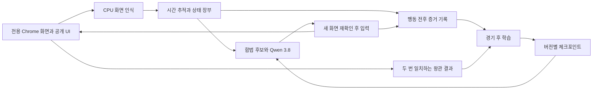
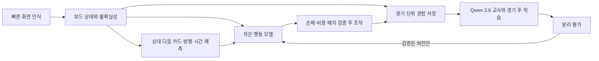

# 플레이 학습 요구사항과 구조

2026-11-15 대화에서 합의한 요구를 보존한다. 구현 상태는 아래 파일과 실행 기록으로 확인하며, 가중치 변경을 실력 향상으로 부르지 않는다.

## 사용자 요구와 현재 적용

| 요구                                                                      | 적용과 검증 범위                                                                                                                                                                                                                                    |
| ------------------------------------------------------------------------- | --------------------------------------------------------------------------------------------------------------------------------------------------------------------------------------------------------------------------------------------------- |
| 폰 없이 Mac에서 실행하고 자원을 적게 쓴다                                 | 현재 학습 대상은 Counterpush 전용 Chrome이다. Android 에뮬레이터 없이 실행한다. Qwen 3.8은 약 16GiB를 쓰므로 저자원 목표를 완전히 달성한 것은 아니다.                                                                                               |
| Qwen **3.8**로 실제 모델이 학습한다                                       | 고정 revision의 27B 4bit 모델과 마지막 MLP LoRA를 사용한다. 학습 전후 해시·버전·Adam 상태를 보존한다.                                                                                                                                               |
| Counterpush AI와 계속 대전한다                                            | `counterpush start --background --matches 0 --hours 8`. 사용자가 전용 Chrome + Playwright 실행을 승인했고 로그인했다. 대화가 끝나도 독립 실행되며 시간 제한을 갖는다.                                                                               |
| 상대 행동을 자동 인식하고 배운다                                          | 화면의 적 표식 → 유닛/효과 분류 → 시간 추적 → 이전 화면에 없었는지 확인 → 행동 전 상태와 카드·방향을 묶어 모방학습한다. 누락되는 행동이 있고 정밀 배치·시간의 학습은 아직 아니다.                                                                   |
| **내 필드의 유닛 종류·위치·상황을 보고 상대가 언제 무엇을 내는지** 배운다 | 행동 이전 `BattleSituation`에 양쪽 유닛, 내 손패·최근 사용 카드·좌표, 엘릭서 범위와 순환 가설을 저장하고 상대 응답 예측 프롬프트에 넣는다. 행동 후 화면은 정답 검증에만 쓴다. 인과관계를 입증한 모델은 아직 아니다.                                 |
| 양쪽 엘릭서는 같은 속도로 충전된다                                        | 내 잔량 변화에 내 확인된 지출을 더해 공유 재생량을 추적하고, 상대의 확인된 지출을 뺀다. 인식이 불확실한 프레임과 입력 중의 빈 막대는 장부에 넣지 않는다.                                                                                            |
| 엘릭서는 **10 상한**, 넘친 충전량은 저장되지 않는다                       | 매 단계 잔량을 0~10으로 자른다. 내 상한에서 가려진 재생은 오차 범위로만 취급한다. 상대의 놓친 행동과 영웅 스킬 때문에 상대 잔량은 단일 숫자 대신 범위로 유지한다.                                                                                   |
| 덱 **8장**, 손패 **4장**, 대기 **4장 FIFO**                               | 카드를 쓰면 큐의 맨 앞을 뽑고 쓴 카드를 맨 뒤에 넣는다. 이후 4회 사용 전에는 돌아오지 않는다. 내 손패로 큐 가설을 좁히고 상대의 놓친 행동이 있으면 가설을 넓힌다. 회귀 검사가 있다.                                                                 |
| **8장 모두 중요**                                                         | 바바리안 통·용광로·고블린 오두막·무덤·영웅 얼음 마법사·진화 기사·독·해골 병사의 고정 덱이다. 카드별 발견/선별/실제 학습 건수를 따로 기록한다. 한 경기에서 카드당 최대 2사례를 선별해 무덤 편중을 제한한다. 이는 모든 카드가 학습됐다는 뜻이 아니다. |
| 카드 능력·스킬·진화·공격 범위와 승리 조건을 고려한다                      | 비용·기본 역할·일부 배치 제약과 최종 왕관 결과만 구현됐다. 정확한 사거리·체력·공격 주기·진화 상태·영웅 능력과 타이브레이크 전체를 구현했다고 말하지 않는다. 검증된 게임 버전별 수치와 화면 인식이 추가로 필요하다.                                  |
| 하루 제한이 있는 복기를 쓰지 않는다                                       | 사이트의 복기 기능을 호출하지 않는다. `rescan`은 **로컬에 저장한 화면**만 다시 인식한다.                                                                                                                                                            |
| 소리를 끈다                                                               | 전용 봇 Chrome에만 `--mute-audio`를 적용한다.                                                                                                                                                                                                       |
| 트로피 손실은 괜찮다                                                      | 실제 게임에서의 손실 허용은 기록하되 현재 학습 대상인 Counterpush와 구분한다. 업그레이드·구매·계정 설정은 플레이 범위에 포함하지 않는다.                                                                                                            |
| 수정은 커밋하고 개선 여부를 사실대로 말한다                               | 코드·참조 자료를 작게 커밋한다. 로그인·원시 경기·모델·체크포인트는 `.data/`에 격리한다. 로컬 커밋과 push/PR을 구분한다.                                                                                                                             |

실제 게임의 Mac 실행 문제와 확인한 BlueStacks 버전은 [README](../README.md)에 남긴다. 현재 목표를 실제 게임 자동 조작으로 되돌릴 때에도 Counterpush의 결과를 실제 게임 성능으로 해석하지 않는다.

## 현재 데이터 흐름과 소유자

- `browser.ts`가 자기 전용 브라우저의 수명·드래그·공개 결과를 소유한다. 게임 엔진 내부 상태나 비공개 API를 읽지 않는다.
- `vision_worker.py`는 고정된 CPU 분류기와 화면 참조를 소유한다. 이동 중인 같은 유닛을 새 카드로 세지 않는다. 독/무덤의 효과와 실제 침입 유닛을 구별한다. 시각 점수는 통계적으로 보정된 확률이 아니다.
- `tracker.ts`가 유닛의 최초 위치와 시간 연속성을, `battle-state.ts`가 손패·FIFO 가설·지출 장부를 소유한다. 과거 스냅샷은 이후 행동으로 바뀌지 않는다.
- `episode.ts`는 경기 단위로 입력과 상대 사례를 연결한다. 손패 교체·비용과 맞는 지출·애니메이션 종료를 확인한다. 오래된 Qwen 판단과 세 번 연속 확인되지 않은 입력은 거부한다.
- 학습기는 한 프로세스에 모델을 유지한다. **같은 정책 버전의 내 행동 PPO를 먼저**, 그다음 상대 사례 모방학습을 실행한다. 체크포인트 쓰기는 단일 잠금으로 보호하며 다음 경기가 갱신된 버전을 사용한다.
- `audit.ts`는 내 확인된 사용, 상대 발견, 선별 자료, 실제 학습을 별도 집계한다. 빈 항목은 0으로 남긴다. 승패와 `improvement: unproven`을 함께 보고한다.

경기 원본은 `.data/counterpush/runs/<시각>/`, 모델 입력 자료는 `datasets/`, 실행 상태와 경기 목록은 `control/`에 둔다. 재인식은 `reprocessed-observations.json`을 만들며 원본을 덮어쓰지 않는다. 기존에 관찰한 같은 시간대의 행동은 재인식에서 제외한다. 새로운 데이터셋 해시만으로 의미상 중복이 완전히 제거되는 것은 아니므로 향후 안정된 이벤트 ID가 필요하다.

## 지금 구조가 비효율적인 이유

1. **정답 품질이 먼저다.** 작은 레벨 표식 누락, 애니메이션을 0 엘릭서로 읽는 현상, 기존 유닛의 재등장은 잘못된 학습으로 이어진다. 데이터가 적을 때에는 모델을 크게 만드는 것보다 이를 고치는 편이 우선이다.
2. Qwen의 판단에는 초기 실측 약 1~2초와 캡처·입력 시간이 든다. 게임의 빠른 수비 반응마다 큰 시각 모델을 실행하는 구조에는 한계가 있다. CPU 인식은 Qwen 판단 대기 중에도 계속되지만 행동 결정 자체는 느리다.
3. 상대의 카드·방향을 맞히는 학습과 **내가 이기는 행동을 고르는 학습은 다르다**. 현재는 같은 어댑터가 두 작업을 배우므로 목표가 간섭할 수 있다. 상대 행동을 관찰했다고 그 행동이 최선이라고 가정해서는 안 된다.
4. 왕관 최종 결과만으로는 어느 수비·배치가 좋았는지 알기 어렵다. 현재 PPO의 보상은 희소하며, 계속 패배하는 데이터만 쌓인다고 좋아지는 것은 아니다.
5. 학습한 장면의 정답 확률이 오른 것은 학습 동작 확인이다. 다른 경기에서 좋아졌는지를 보여주는 분리 평가와 새 버전 채택 기준은 아직 없다.

## 권장 구조: 상태 추적 + 상대 예측 + 빠른 행동 모델

아래는 **다음 구현 단계의 제안**이다. 작은 행동 모델과 상대 전용 예측기는 현재 배포되지 않았다.

**1. 상대 예측기를 별도 목표로 학습한다.** 입력은 행동 전 보드·최근 몇 초의 이벤트·상대 잔량 범위·순환 가설이고, 정답은 상대 카드/방향/발생 시간 구간이다. 내 기사·얼음 마법사·오두막 등이 언제 어디에 있었는지를 보존한다. 먼저 카드 빈도만 쓰는 기준 모델과 비교해 보지 않은 경기에서 NLL·top-k·방향·시간 오차를 잰다. 반응을 관찰한 자료만으로 특정 행동이 원인이었다고 단정하지 않는다.

**2. 조작은 작은 모델, Qwen 3.8은 교사로 둔다.** 작은 모델이 구조화한 필드와 상대 예측을 받아 후보 중 행동을 고르고, Qwen은 애매한 장면과 경기 후 판단 자료 생성에 쓴다. Qwen 판단도 검증할 대상이며 정답 오라클이 아니다. 목표 반응 시간은 예를 들어 200ms이지만 실제 Mac에서 측정하기 전에는 성능으로 보고하지 않는다. 사용자 선택인 Qwen 3.8을 유지하면서 매 프레임의 큰 모델 호출과 메모리 점유 시간을 줄이는 방향이다.

**3. 경험은 상황별로 균형 있게 저장한다.** 카드·라인·위험도·내 필드 조합·엘릭서 구간·순환·버전으로 조회한다. 빈번한 무덤 장면만 추가하지 말고 부족한 카드, 실패한 수비, 불확실한 인식을 우선 확인한다. JSONL을 원본 증거로 두고 필요해지면 SQLite에 이벤트/관찰/행동/결과/버전을 색인한다. 지금은 구조가 정해진 필터가 중심이므로 벡터 DB 추가가 우선은 아니다. 이미지 유사 상황 검색을 실제로 도입할 때 임베딩 색인을 검토한다.

**4. 학습과 채택을 구분한다.** 경기를 통째로 학습/평가로 나눈다. 같은 추적 유닛의 이웃 프레임이 양쪽에 섞이지 않도록 한다. 상대 예측 정확도, 내 입력 성공률, 카드별 자료 범위, 같은 덱/난이도의 승률·왕관 차이·타워 피해를 별도 기록한다. 새 모델과 기준 모델을 번갈아 대전시켜 표본 수와 불확실성까지 보고하고, 악화한 버전은 보존한 이전 모델로 돌아간다. 실제 타워 체력 인식이 검증되기 전에는 피해량 보상을 만들지 않는다.

**5. 버전 계약을 지킨 채 비동기화한다.** 한 경기 동안 행동 모델은 고정한다. Qwen 특징은 그 특징을 만든 어댑터 버전과 묶는다. 오래된 정책의 기록을 현재 PPO에 그대로 재사용하지 않는다. 상대 예측기의 지도학습 자료는 재사용할 수 있지만 행동 정책의 데이터와 다른 경로다. Mac 한 대에서는 분산 시스템을 도입할 필요 없이 별도 작업 큐와 경기 사이의 모델 교체로 시작한다.

## 완료 판단

2026-11-15 자료 감사에서 이미 활성화된 무덤에 새 묘비가 보이는 것을 새 카드로 받은 오류를 확인했다. 과거 무덤 관찰 15건 중 14건은 행동 전 화면에 큰 보라색 효과가 있어 격리했고, 별도의 얼음 마법사 1건도 이전 화면의 정체가 모호해 격리했다. 새 묘비의 부재만 확인하던 방식을 바꾸고 **행동 전 라인의 무덤 효과**가 남아 있으면 학습하지 않는다. 격리 목록은 `.data/counterpush/quarantine.json`이며 자료 준비와 실제 Python 학습 양쪽에서 검사한다. 원시 화면과 이전 체크포인트는 삭제하지 않았다.

그 자료가 섞인 v8~v34 계열을 계속 이어가지 않고, 마지막으로 시각 검증했던 v7을 새 번호 v35로 복구했다. 화면을 다시 확인한 오두막·바바리안 통·독·해골 병사 4건만 재학습해 v36을 저장했다. 이는 자료 품질 복구이며 승률 향상 증거가 아니다. 이전 엘릭서 보정 복구 기록도 별도로 남아 있다. 자료 감사·복구·실제 모델 갱신의 상세 기록은 `.data/counterpush/control/label-recovery.json`과 `audited-recovery-20261115/`에 보존한다.

또한 결과 라벨의 `, overtime` 접미사 때문에 연장전 종료를 인식하지 못한 사례를 고쳤다. 두 번 일치하는 왕관 수와 제한된 접미사만 인정한다. 대전/결과 화면이 45초 동안 확인되지 않으면 화면 대기 상태와 오류를 기록하고 멈추며, 알 수 없는 결과를 보상으로 만들지 않는다.

- 기본 규칙은 FIFO·비용·10 상한·미래 정보 누출 회귀 검사로 확인한다.
- 8장별 상대 발견/학습 건수를 제시하고 0건을 숨기지 않는다. 근거 없는 카드 사례를 채워 넣지 않는다.
- 입력 성공, 실제 어댑터 갱신·재적용, 이어지는 대전을 각각 확인한다.
- **승률이나 보지 않은 상황의 판단이 검증되기 전에는 ‘실력이 개선됐다’고 보고하지 않는다.**

## 설계 참고

[Ross와 Bagnell의 모방학습 연구](https://proceedings.mlr.press/v9/ross10a.html)는 학습한 정책이 이후 만나게 될 상태를 바꾸므로 고정 자료 모방의 오류가 누적될 수 있음을 다룬다. 자신의 실제 플레이에서 생긴 상황을 수집·평가해야 한다는 설계 근거이며, 여기서 논문의 알고리즘을 구현했다는 뜻은 아니다.

[IMPALA](https://proceedings.mlr.press/v80/espeholt18a.html)는 행동과 학습을 분리하되 정책 차이를 보정하는 구조를 제시한다. 이 프로젝트에서는 분리와 버전 관리의 참고로만 삼고, 분산 처리나 V-trace를 구현했다고 주장하지 않는다. 위의 작은 모델 전환은 현재 코드의 지연·자료 부족을 고려한 설계 제안이며 효과는 미측정이다.
