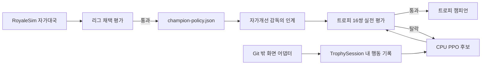

# 플레이 학습 요구사항과 구조

2026-11-15 대화에서 합의한 요구를 보존한다. 구현 상태는 아래 파일과 실행 기록으로 확인하며, 가중치 변경을 실력 향상으로 부르지 않는다.

2026-11-20에 학습과 평가의 대상을 실제 클래시로얄 트로피 경기로 정하고 Counterpush 웹 게임 실행과 Qwen 후보 학습 경로를 지웠다. 아래에는 지금 코드에 남은 판단 보정·배치·트로피 학습의 근거만 둔다. Counterpush 기록에서 찾은 문제가 현재 보정의 이유인 곳은 그 사실만 짧게 남긴다. 이후 단계는 [자가개선 계획](self-improvement-plan.md)을 따른다.

## 스킬 낭비·무덤 수비·오두막 지출의 회귀 수정

2026-11-17 Counterpush 기록에서 2 엘릭서에 대기와 스킬만 남으면 비슷한 확률의 추첨을 반복하다 결국 스킬을 쓰고, 바바리안 통은 위치 후보 여러 개의 확률을 합치면 대기 하나보다 유리해지는 편향을 확인했다. 행동 사전 보정(`clash_bot.qwen.action_prior`)은 카드별 위치 후보 수로 확률을 정규화하고, 관측된 스킬 기회가 없거나 통 경로에 적이 없는 선택에는 명시적인 비용을 더한다. 알려진 상대 고블린 통의 순환·추정 자원도 빈 통 지출의 비용에 반영한다. 합법 행동은 지우지 않는다. 이는 학습으로 알아낸 규칙이 아니라 공개한 사전 보정이다. 트로피는 화면 어댑터가 넘긴 보정을 실제 선택·저장 확률·PPO에 같은 값으로 쓴다.

`combat-projection.json`은 이동·등장 지연·피해 예측의 공유 기준이다. 같은 유닛을 두 번 이상 추적한 속도와 화면에서 읽은 체력 구간을 사용해 얼법 등장 피해, 통의 굴러가는 경로, 독 영역에 머무를 시간과 틱 피해, 처치 가능성 구간을 계산한다. 처음 본 유닛을 정지 상태로, 읽지 못한 체력을 최대 체력으로 채우지 않는다. `h`는 현재 접촉, `d`·`k`·`e`는 예측 피해·처치·체류 시간이다. 선택된 행동의 예측과 원본 화면 사실을 함께 기록한다. 수치는 레벨 11 참고값이며 화면에 맞춰 보정하지 않았다(`counterpushCalibrated: false`, 키 이름은 `rulesID` 때문에 유지). 방향 전환·대상 변경·정확한 독 틱 경계·배지 중심과 발 위치의 오차가 남아 있어 실제 처치를 보장하지 않는다. 스킬의 `q`도 주변 전투 기회이며 둔화 표식과 동결 대상 자격을 확인한 값은 아니다.

판단 계약 후보(`core/policy/candidates.ts`)의 얼법·통 후보는 배치 지연 뒤 적 위치와 통 이동을 비교한다. 수비가 급할 때 얼법 후보 5개 중 2개를 킹타워 뒤에 고정하던 할당은 없애고 대응 위치 4개와 후방 1개를 비교한다. 빈 필드의 빌드업에는 양쪽 킹타워 뒤와 아군 지원 위치를 유지한다. 실제 미끼 덱 대응은 검증하지 않았다. 트로피 자기 행동 학습의 구현·실행 증거는 아래 별도로 구분한다.

추가 실전 오배치를 재현해 오두막에 일반 유닛용 타워 앞 기본 좌표가 섞이는 경로를 제거했다. `predictive-placement.ts`는 후보의 카드별 배치를 나누고 유닛·통의 요격 위치를 소유한다. 오두막은 `hut-placement.ts`가 유인·활성 범위, 기존 오두막과 독 위험을 격자에서 비교한다. 통은 근접 유닛용 옆 배치를 쓰지 않고 전진 경로를 고른다. 독과 무덤은 `area-spell-placement.ts`가 만든다. 독은 움직이지 않는 건물이 미래에 영역 안으로 걸어 들어오는 것처럼 취급하던 오차 확대를 고쳤고, 가능한 이동의 피해 상한과 현재 궤적의 참고 피해(`n`)를 구분한다. 무덤도 아군 지원·관측된 수비와 독 위치를 비교한 타워 오프셋 후보를 사용한다.

선택 분포의 명시적 사전 보정은 빈 독, 중복 독, 저엘릭서의 이른 오두막과 기존 오두막 중첩, 지원 없이 상대 독·얼법·오두막이 돌아올 수 있는 무덤, 활성 무덤 수비 자원 유출, 킹타워를 깨울 위험을 비교한다. 상대 손패는 순환과 엘릭서 범위로 판단하며 정확한 패를 만들지 않는다. `towers`는 알려진 타워 체력 비율 또는 `?`다. 현재 실전에서 타워 체력·활성 상태를 모두 읽지는 않으므로 킹타워 위험을 보수적으로 적용한다. 시뮬레이션에서 왕 체력이 깎였거나 공주 타워가 파괴된 공개 상태라면 이 보정을 해제한다. 이것은 실전의 모든 타워 상태·마무리 피해를 정확히 읽었다거나 전략을 전부 학습했다는 뜻이 아니다.

이동 유닛의 독 궤적 가치는 관측된 속도가 있을 때 2초까지만 계산하며, 처음 본 이동 유닛을 8초 동안 멈춰 있는 표적으로 채우지 않는다. 고정 건물은 전체 지속 시간을 비교한다. 가능한 미래 이동에 대한 피해 상한은 별도 구간에 남기며 이를 선택의 확정 가치로 쓰지 않는다. 적은 궤적 피해만 있는 공격 독도 별도 비용을 가진다. 같은 보정은 `clash_bot.qwen.action_prior serve`의 CPU 전용 JSON 통신으로 Git 밖 화면 어댑터에 제공한다. 이 통신은 모델·가중치를 읽거나 학습·채택을 실행하지 않는다. 어댑터가 모듈 이름으로 실행하므로 경로를 옮기지 않는다.

판단 문자열(decision-v3)에는 무덤의 관측 경과 시간(`@2s`)과 알 수 없는 시작 시점(`@?s`), 스킬의 비용·순환 비발생·효과 조건, 오두막의 범위와 방어 자원 비교를 함께 전달한다. 이는 참고 수치이며 실제 게임 물리의 완전 일치를 뜻하지 않는다. 2026-11-16 Counterpush 기록에서 연패가 이어지면 이동 평균 기준값이 -1에 수렴해 패배의 정책 기울기가 거의 사라지는 것을 확인했다. 트로피 PPO가 가치 기준을 [-0.5, 0.5]로 제한하는 이유다.

자가대국과 빠른 실전 정책은 엘릭서 8 이상에서도 대기를 합법 후보로 유지한다.

시뮬레이션의 무덤 단계도 공개된 사용 기록의 시간·위치로 계산한다. 비공개 주문 타이머를 읽지 않고, 사용 기록이 없거나 같은 곳의 효과가 겹치면 모르는 값으로 둔다. 이 시간은 주문 사용 이후이며 실전 화면은 효과를 처음 관측한 이후이므로 관측 지연만큼 차이가 남는다.

빈 필드에서 기사·용광로·해골병사·얼음 마법사는 킹타워 뒤 빌드업을 비교하며, 침입한 적과 다리로 접근하는 적은 별도 수비 후보를 사용한다. 값싼 순환도 남길 수비 엘릭서와 확인한 진화 카운터를 함께 본다. 상대 수비 카드가 불명인 경우와 복귀가 확인된 경우의 무덤 벌점을 구분한다. 이것은 명시한 사전 보정이며 학습 성공의 증거가 아니다.

무덤 위치는 Counterpush에서 승리한 상대의 효과 중심을 180도 회전한 타워 상대 오프셋(`profiles/counterpush.json`의 `observedGraveyardCenters`)으로 보정한다. 보정값을 쓸 때 일반 타워 정중앙 후보를 다시 붙이지 않는다. 효과 중심은 실제 터치 위치의 정확한 복원값이 아니다. 로켓병이 식별되면 중앙 유인 후보와 독·바통 피해를 비교한다.

## 트로피 화면 실험과 자기 행동 학습

### 트로피 화면에서의 드릴·무덤 수비 실험

기존 트로피 실험은 체력 막대의 색과 위치만 사용해 드릴의 종류·출현 단계를 판단할 수 없었다. `perception/trophy_vision.py`는 기존 CPU 검출기와 171종 그림 분류기의 원시 라벨을 연결한다. 체력 막대 색으로 진영을 구분하며 위치만으로 진영을 정하지 않는다. 영웅·진화의 외형 분류는 능력 사용 가능 상태나 효과의 판독과 별개다. 배치 시계는 검토한 참조와 일치하는 화면 단서이며, 시계만 보고 드릴이라고 단정하지 않는다. 무덤·독 영역은 보라색과 그림 분류를 함께 사용하는 후보라서 실험 연결에서 시간상 반복 확인하더라도 누락·오인식이 남는다.

드릴 인식 시 기사 근처 수비를 비교하고, 출현 전 해골병사와 고블린이 보이지 않는 불명 체력 드릴에 대한 통 사용은 낮춘다. 사용자가 설명한 **드릴 등장 후 해골병사와 통**, **통 피해로 드릴을 끝낼 수 있는 경우의 소환 고블린 정리**를 판단 요구로 기록한다. 현재 드릴 체력을 읽지 않으므로 통으로 확정 처치하거나 완막한다고 보고하지 않는다. 상대 무덤이 활성화된 동안 다른 라인 공격·후방 빌드업의 우선순위를 낮추고, 독·얼법·기사·해골·통의 근처 수비 후보를 비교한다. 엘릭서가 불리할 수 있고 사용 후 3 미만이 남는 불필요한 지출도 낮춘다. 무덤 뒤 독은 현재 궤적에서 피해가 예상되는 상대 유닛과 사용 후 3 이상의 수비 자원이 있을 때 추가 가치를 부여한다. 이는 명시한 사전 보정이며 가중치가 학습해 얻은 실력으로 보고하지 않는다.

실제 게임과 Counterpush의 가로 간격을 섞지 않도록 프로필의 `tileScale`을 위치·속도·타워 배치 금지 영역에 함께 적용한다. 실제 화면에서 측정한 공주 타워 중심은 정규화 화면의 x=85/283이고, 가로 한 타일은 18px다. 사용자의 **타워 바로 바깥 한 칸** 교정은 트로피 실험 프로필의 `graveyardPlacement: tower_adjacent_outer_tile`로 효과 중심 추정보다 우선한다. 이 입력은 좌우 x=67/301, 상대 타워와 같은 세로 타일을 사용하며 타워 정중앙 후보를 붙이지 않는다. 측정한 화면 좌표와 게임 내부의 정확한 충돌 지도를 동일시하지 않는다.

로컬 실험 연결은 확인한 내 주문 입력, 상대의 반복 관측·이전 프레임의 공간상 부재, 부분 지출·순환 범위를 기록한다. 생성된 고블린·해골 등을 새로운 카드 지출로 세지 않으며 같은 카드의 짧은 재관측도 중복 차감하지 않는다. 놓친 지출이 있으므로 상대 엘릭서의 하한은 0이고 정확한 손패·체력·능력은 불명이다. 이전 읽기 전용 기록은 `learningEligible: false`로 보존한다. 새 트로피 자기 행동 학습은 아래 별도 계약으로 수집한다.

### 트로피 내 행동의 자동개선

2026-11-17 사용자의 추가 요구는 **현재 상황과 내 플레이만** 보는 자동개선이다. `trophy-own-trajectory-v1`은 행동 직전 화면·관측 특징, 합법 행동별 특징·명시적 사전 보정, 실제 선택 확률·가치, 확인된 내 입력/대기, 두 번 일치하는 크라운 결과를 저장한다. 상대 행동을 정답으로 모방하거나 비공개 손패를 만들어내지 않는다. 적 유닛은 현재 화면 상황의 일부이며 인식 불명은 그대로 남긴다.

학습 역할의 새 경기 2판마다 CPU MLX로 별도 작은 정책을 PPO 갱신한다. 확인되지 않은 터치가 하나라도 있거나 전이가 8개 미만이면 그 경기는 제외한다. 경기당 최대 128개 전이를 시간에 따라 균등 선별하고 경기당 가중치를 같게 둔다. 보상은 `0.8 × 승패(-1/0/1) + 0.2 × 크라운 차이/3`이다. 누락이 많은 타워 HP는 학습 보상으로 사용하지 않는다. 경기 전체 보상이므로 개별 행동의 패배 원인을 정확히 분리한 학습은 아니다.

수집과 학습 모두 `0.99 × softmax((원시 점수 + 고정 보정)/온도) + 0.01/후보 수`를 사용한다. 온도는 일반 상황 1, 급한 타워 수비 0.5다. 이전 읽기 전용 정책의 탐욕 선택·one-hot 기록은 재사용하지 않는다. 저장한 확률·가치를 수집 체크포인트로 다시 계산해 일치한 자료만 학습한다. PPO는 3 epoch, batch 16, 학습률 1e-4, 비율 제한 0.2, 기울기 크기 1, KL 상한 0.02이며 최대 4회 작은 학습률로 재시도한다. 연패 중에도 가치 기준을 [-0.5, 0.5]로 제한해 결과 신호가 사라지지 않게 한다. 정확한 값의 단일 기준은 `contracts/trophy-learning.json`이다.

갱신 뒤 후보와 기존 챔피언은 최소 16쌍/32판의 별도 고정 평가를 받는다. 쌍마다 역할 순서를 미리 무작위 등록하고 평가 중 학습하지 않는다. 실제 매칭 상대·시드가 같은 경기는 아니므로 동일 조건 자가대국으로 표현하지 않는다. 승리 차이의 정확 쌍별 검정·효과 크기·시도별 유의수준 지출은 공통 `qualification.json`을 따른다. 남은 경기를 모두 이겨도 통과할 수 없으면 조기 탈락만 허용한다. 전체 원본 화면·결과·분포·모델·행동 지문을 재검사해 통과한 후보만 별도 게시 포인터로 채택한다. 탈락하면 챔피언을 유지하고 후보 학습을 이어간다. 가중치 갱신·낮은 학습 손실을 실전 향상으로 보고하지 않는다.

자가개선 감독이 넘긴 시뮬레이터 챔피언도 같은 평가를 받는다. 진행 중인 평가가 없고 학습 묶음이 비었을 때 가져오며, 학습 중이던 PPO 후보는 평가가 끝날 때까지 보관한다. 통과하면 챔피언이 되고 PPO가 그 가중치에서 이어 학습하며, 탈락하면 보관한 후보로 돌아간다. 같은 가중치는 다시 평가하지 않고, 평가 보고서에 후보 출처(`candidateSource`)를 남긴다. 시뮬레이터에서 채택된 정책이라는 사실만으로 실전 우위를 가정하지 않는다.

### 트로피 타워 피해 억제

`FastPolicy.predict`의 선택적인 타워 수비 입력은 관측한 적의 위치·속도와 배치 지연 뒤 위치를 비교한다. 타워 쪽으로 접근한 미대응 위협이 급하면 해당 행동에 명시적 점수 보정을 적용한다. 읽기 전용 실험은 최고 점수를 선택했지만 새 학습 경로는 같은 보정과 낮은 온도의 범주 분포로 수집·학습·평가한다. 해당 위협과 무관한 공격·후방 빌드업·대기의 점수를 낮추고, 다른 라인의 남은 위협과 수비 비용도 비교한다. 이미 관측한 수비 유닛, 확인한 배치 직후의 짧은 대기 구간과 활성 수비 독을 고려해 중복 지출을 줄인다. 단일 기사에게 모든 적을 동시에 막을 수 있는 능력을 부여하지 않으며, 분류가 불명인 적에 대한 지상 전용 수비의 효과도 낮춘다. 타워 체력·유닛 타깃·미관측 처치를 정답으로 채우거나 실제 피해량을 예언하는 계산은 아니다.

기존 정책의 기본 추론과 학습 특징은 바꾸지 않는다. 타워 보정은 트로피 어댑터에서 명시적으로 켜고 점수·대응 근거·선택 방식을 기록한다. 새 자기 행동 학습은 같은 보정을 수집·학습·평가에 사용하고 별도 가중치만 바꾼다. 일반 카드 생성기의 침입 대응 후보에는 실제 측정한 이동과 입력·배치 지연을 반영한 위치를 추가한다. HP가 낮다는 이유만으로 무조건 과투자하거나 이미 수비하는 곳에 계속 카드를 추가하는 정책으로 취급하지 않는다.

맥의 [Vision 문자 인식](https://developer.apple.com/documentation/vision/vnrecognizetextrequest)으로 검토한 공주 타워 HP 글자 영역만 CPU에서 읽는다. `perception/macos/tower-text.swift`는 macOS 14 이상 Apple Silicon의 로컬 실험이며 외부 전송과 추가 Python 라이브러리를 사용하지 않는다. 프로젝트 루트에서 `xcrun swiftc -O -target arm64-apple-macosx14.0 apps/agent/python/clash_bot/perception/macos/tower-text.swift -o .data/macos/tower-text`로 Git 제외 경로에 빌드한다(출력 디렉터리는 먼저 만든다). `serve` 인자의 JSON 줄 단위 요청은 `{"op":"read","image":"정규화한 368×652 PNG 경로"}`이고 응답은 좌우 공주 타워의 숫자 또는 `null`이다.

`TowerHealthTracker`는 서로 다른 연속 화면에서 같은 숫자가 두 번 보였을 때만 현재 HP로 사용한다. 가림·누락·중복 글자·긴 관측 간격과 확인된 값보다 커진 숫자는 불명으로 둔다. OCR 신뢰도는 HP 정확도 확률이 아니며 동일 오독이 반복될 수도 있다. 관측된 HP 감소량은 별도로 누적하지만 왕타워 HP나 파괴 여부를 읽은 것은 아니다. 누락된 글자를 0이나 최대 HP로 바꾸지 않으므로 마지막 파괴 피해를 포함한 전체 피해를 확정할 수도 없다. 피해 감소나 승률 개선은 같은 조건의 실제 경기 비교가 있어야 확인할 수 있다.

실전 판단에는 상대의 추가 순환 횟수 범위도 전달한다. 모르는 값을 정확한 손패로 바꾸지 않는다. 얼법 등장 범위, 바바리안 통의 전진 경로·폭, 독 영역에 현재 관측된 적이 몇 기 들어가는지 `h`로 계산한다. 수치의 단일 기준은 `contracts/placement-effects.json`이며 기존 카드 지식도 같은 값을 읽는다. `h`는 현재 접촉 가능성으로, 미관측 유닛의 부재·공중 여부·미래 이동·독 8초 전부의 피해를 증명하지 않는다. 실제 피해·성공 여부는 별도 전투·실전 평가가 필요하다.

## 사용자 요구와 현재 적용

2026-11-15 요구 중 Counterpush 연속 대전·전용 Chrome·소리 끄기·하루 제한 복기 미사용, Qwen 3.8 학습, 상대 행동 모방은 2026-11-20에 그 실행 경로와 함께 지웠다. 남은 요구의 적용 범위는 다음과 같다.

| 요구                                                                      | 적용과 검증 범위                                                                                                                                                                                                                      |
| ------------------------------------------------------------------------- | ------------------------------------------------------------------------------------------------------------------------------------------------------------------------------------------------------------------------------------- |
| 폰 없이 Mac에서 실행하고 자원을 적게 쓴다                                 | 실제 클래시로얄 화면은 맥에서 돌리며 캡처와 입력은 Git 밖 ADB 어댑터가 맡는다. 약 16GiB를 쓰던 Qwen 3.8 27B는 제거했다. 자가대국과 트로피 학습은 작은 빠른 정책을 CPU에서 학습하고, 인식은 ONNX CPU를 쓴다.                           |
| **내 필드의 유닛 종류·위치·상황을 보고 상대가 언제 무엇을 내는지** 배운다 | 별도 상대 예측기는 없다. 자가대국 탐색은 공개 카드로 추정한 상대 덱·손패 가설과 고정 상대 정책의 대응을 쓴다. 인과관계를 입증한 모델은 아니다.                                                                                        |
| 양쪽 엘릭서는 같은 속도로 충전된다                                        | 내 잔량 변화에 내 확인된 지출을 더해 공유 재생량을 추적하고, 상대의 확인된 지출을 뺀다. 인식이 불확실한 프레임과 입력 중의 빈 막대는 장부에 넣지 않는다.                                                                              |
| 엘릭서는 **10 상한**, 넘친 충전량은 저장되지 않는다                       | 매 단계 잔량을 0~10으로 자른다. 내 상한에서 가려진 재생은 오차 범위로만 취급한다. 상대의 놓친 행동과 영웅 스킬 때문에 상대 잔량은 단일 숫자 대신 범위로 유지한다.                                                                     |
| 덱 **8장**, 손패 **4장**, 대기 **4장 FIFO**                               | 카드를 쓰면 큐의 맨 앞을 뽑고 쓴 카드를 맨 뒤에 넣는다. 이후 4회 사용 전에는 돌아오지 않는다. 내 손패로 큐 가설을 좁히고 상대의 놓친 행동이 있으면 가설을 넓힌다. 회귀 검사가 있다.                                                   |
| **8장 모두 중요**                                                         | 바바리안 통·용광로·고블린 오두막·무덤·영웅 얼음 마법사·진화 기사·독·해골 병사의 고정 덱이다. 자가대국 체크포인트의 `training.optimizerCoverage`가 실제 최적화에 쓰인 카드와 빠진 카드를 기록한다. 모든 카드가 학습됐다는 뜻은 아니다. |
| 카드 능력·스킬·진화·공격 범위와 승리 조건을 고려한다                      | `core/knowledge.ts`의 참고 수치, `special-state.ts`의 진화 횟수·능력 상태, 자가대국 엔진의 진화·히어로 능력을 쓴다. 실제 화면과의 수치 일치, 모든 챔피언 스킬·타이브레이크·전투 물리는 미검증/미구현이다.                             |
| 트로피 손실은 괜찮다                                                      | 명시적으로 요청한 트로피 자동개선은 새 자기 행동 궤적을 별도 CPU 정책에만 학습하고 고정 평가를 통과한 후보만 채택한다. 이전 읽기 전용·평가 기록은 학습하지 않는다. 업그레이드·구매·계정 설정은 플레이 범위에 포함하지 않는다.         |
| 수정은 커밋하고 개선 여부를 사실대로 말한다                               | 코드·참조 자료를 작게 커밋한다. 원시 경기·모델·체크포인트는 `.data/`에 격리한다. 로컬 커밋과 push/PR을 구분한다.                                                                                                                      |

트로피의 화면 입력·인식 참조는 이 Mac에서 명시적으로 허용된 로컬 연결이다. 공개 학습 코어와 개인 화면 어댑터의 검증 범위를 구분하며 과거 Counterpush 결과를 실제 게임 성능으로 해석하지 않는다.

## 현재 데이터 흐름과 소유자

추가 사용자 요구: 빈 필드에서 모든 유닛을 타워 뒤로 고정하지 않는다. 생성형 건물·생성형 유닛과 그 자식 유닛의 상호작용, 이동 속도·사거리·공격/배치 지연을 고려한다. 무덤 수비는 고정된 해골 생성 순서와 경과 시간을 다룬다. 이 요구를 단순한 카드 사용 횟수로 충족했다고 보고하지 않는다.

- `vision_worker.py`는 고정된 CPU 분류기와 화면 참조를 적재하고 요청을 처리한다. 카드 식별은 `classifier.py`, 유닛 표식은 `markers.py`, 독/무덤 효과는 `effects.py`가 맡는다. 독/무덤의 효과와 실제 침입 유닛을 구별한다. 시각 점수는 통계적으로 보정된 확률이 아니다. 지금은 Git 밖 화면 어댑터가 이 워커를 실행한다.
- `card-cycle.ts`가 손패·FIFO 가설을, `elixir-ledger.ts`가 지출 장부를 소유하고 `battle-state.ts`가 이를 판단 상황으로 묶는다. 과거 스냅샷은 이후 행동으로 바뀌지 않는다.
- 트로피의 경기·평가·학습 순서는 `TrophySession`이, 자가대국은 Python 리그가, 둘 사이의 챔피언 인계는 자가개선 감독이 소유한다. 자세한 위치는 [실행과 학습 코드의 책임](architecture.md)에 있다.

## 지금 구조가 비효율적인 이유

2026-11-15 추가 적용:

- 타워 뒤 2점만 주던 일반 유닛 후보를 후방 안쪽·중앙·전진·아군 지원·접근 적 대응으로 바꿨다. 타워와 영웅 UI 영역을 피하며 화면 보정은 `profiles/counterpush.json`이 소유한다. 한 손패의 후보는 26개 이하여야 한다. 아직 모든 합법 타일을 직접 출력하는 자유 좌표 정책은 아니다.
- `src/core/knowledge.ts`에 레벨 11의 사거리·공격 주기·배치/첫 타격 지연·이동 분류·스폰 주기와 진화/영웅 조건을 출처와 함께 기록했다. 2026-11-14 현재 수치 자료와 Supercell 변경 공지를 대조했다. 실제 화면에서 모든 수치가 일치한다고 검증한 것은 아니다. 이동 수치 60/90/120을 타일/초로 잘못 사용하지 않는다.
- `FieldDynamics`가 양쪽 본체와 파이어 스피릿·창 고블린을 별개로 추적하고 화면상 속도를 추정한다. 자식 유닛은 새 카드 지출이나 FIFO 이동을 만들지 않는다. 부모가 여러 개면 정확한 부모를 꾸며내지 않는다. 관측된 자식 트랙 수는 실제 총 생성 수나 확정된 쿨다운이 아니다. 진화/영웅은 실제 분류가 뒷받침할 때만 표시한다.
- 무덤은 새 묘비 개수 대신 활성 영역을 추적한다. 수비 후보는 현재 해골/반복 관측에서 얻은 예측, 사거리, 얼음 마법사의 **이미 존재하는 해골에 대한 배치 피해**, 독 위험을 고려해 격자에서 고른다. 바바리안 통 한 번이나 단일 근접 유닛이 전체 무덤을 지운다고 가정하지 않는다.
- `SpawnPatterns`는 경과 시간과 상대 오프셋을 독립된 시전마다 모은다. 3개 이상의 시전에서 반복 관측돼야 미래 등장 후보를 제공한다. 첫 확실한 시각 인식 시점은 실제 생성 시점과 다르므로 이를 구분한다. 공격/수비 방향을 검증 없이 합치지 않고 짧은 관찰·이미 진행 중이던 효과·관찰 공백·겹친 시전은 정확한 패턴 근거로 쓰지 않는다. 아직 충분한 실제 패턴을 배웠다는 주장은 하지 않는다.

정확한 충돌/경로·타워 체력·타깃 재선정·모든 스킬 효과를 재현하는 전투 시뮬레이터는 아니다. 피해량과 무덤 수비 성공을 직접 측정하기 전에는 학습 완료나 성능 향상을 선언하지 않는다.

### 히어로·챔피언·진화 추가 반영

- `EvolutionCycles`는 기사와 용광로를 각각 추적한다. 같은 카드를 일반 형태로 2회 낸 뒤 다음 진화, 진화 사용 후 재충전이라는 참고 규칙이다. 다른 카드 사용·능력 사용·자식 생성은 진화를 충전하지 않는다. FIFO와 별개다. 확인되지 않은 내 입력은 횟수 가설을 넓히고, 상대는 놓친 행동이 있으므로 처음부터 범위로 둔다. `counterExact`는 입력 장부의 확정 여부이며 엔진 주기 검증이 아니다(`engineCycleVerified: false`). 필드의 실제 진화형 인식과 다음 소환 형태의 예상은 구별한다.
- [2026년 8월 공식 변경](https://supercell.com/en/games/clashroyale/blog/news/final-august-balance-changes-826/)의 기본 규칙은 소환당 1회이고 보스 도적은 예외다. [2025년 10월 순환 개편](https://supercell.com/en/games/clashroyale/blog/release-notes/october-update-2025/) 뒤 챔피언도 보통 카드와 같이 순환한다. 과거의 생존 중 덱 이탈·3장 순환을 적용하지 않는다. [현재 챔피언 안내](https://support.clashroyale.com/hc/en-us/articles/49484915467291-Champions)에서 같은 종류의 가장 최근 소환만 능력을 쓴다는 점을 재확인했다. 얼음 마법사의 2 엘릭서·둔화 대상 동결은 [공식 히어로 소개](https://support.clashroyale.com/hc/en-us/articles/54836231287963-What-s-New-September-2026)를 따른다.

## 학습 신호의 한계

1. **정답 품질이 먼저다.** 작은 레벨 표식 누락, 애니메이션을 0 엘릭서로 읽는 현상, 기존 유닛의 재등장은 잘못된 학습으로 이어진다. 데이터가 적을 때에는 모델을 크게 만드는 것보다 이를 고치는 편이 우선이다. 실제 화면의 인식 오류를 재는 일은 계획 문서의 라벨링 단계가 맡는다.
2. 왕관 최종 결과만으로는 어느 수비·배치가 좋았는지 알기 어렵다. 트로피 PPO의 보상은 희소하며, 계속 패배하는 데이터만 쌓인다고 좋아지는 것은 아니다.
3. 학습한 장면의 정답 확률이 오른 것은 학습 동작 확인이다. 2026-11-16에 로컬 리그 채택 기준과 실전 고정 모델 비교를 추가했으며, 그 시점까지 충분한 실전 표본으로 승률이 개선됐다는 결과는 없었다.

2026-11-16에 제안한 구조 중 로컬 정책·가치 모델, 정보 집합 수읽기, 자가대국, 기준 모델 비교와 실전 고정 모델 비교가 남아 있다([자가대국 구현 문서](arena-learning.md)). 별도 상대 예측기는 구현하지 않았다.

## 완료 판단

- 기본 규칙은 FIFO·비용·10 상한·미래 정보 누출 회귀 검사로 확인한다.
- 카드별 학습 표본 수를 제시하고 0건을 숨기지 않는다. 근거 없는 카드 사례를 채워 넣지 않는다.
- 입력 성공, 실제 가중치 갱신·재적용, 이어지는 대전을 각각 확인한다.
- **승률이나 보지 않은 상황의 판단이 검증되기 전에는 ‘실력이 개선됐다’고 보고하지 않는다.**

## 설계 참고

[Supercell 2026년 1월 공지](https://supercell.com/en/games/clashroyale/blog/release-notes/january-balance-changes-26/)는 무덤의 무작위 생성을 고정 순서로 바꿨고, [2월 공지](https://supercell.com/en/games/clashroyale/blog/news/february-balance-changes-26/)는 생성 위치를 다시 조정했다. [6월 공지](https://supercell.com/en/games/clashroyale/blog/release-notes/june-balance-changes-2026/)에서 무덤은 12마리, 용광로 사거리는 5.5타일로 바뀌었다. 이전 패턴 도표를 최신 게임에 그대로 대입하지 않는다.

현재 레벨 11 참고 수치: [용광로](https://www.royaletools.com/cards/furnace), [얼음 마법사](https://www.royaletools.com/cards/ice-wizard), [기사](https://www.royaletools.com/cards/knight), [해골](https://www.royaletools.com/cards/skeletons), [오두막](https://www.royaletools.com/cards/goblin-hut), [무덤](https://www.royaletools.com/cards/graveyard), [독](https://www.royaletools.com/cards/poison), [바바리안 통](https://www.royaletools.com/cards/barbarian-barrel). 이는 제3자 게임 수치 자료이며 실제 화면에서 잰 값으로 표시하지 않는다. 용광로 페이지의 오래된 건물 분류 문구 대신 Supercell의 [이동 유닛 개편 공지](https://supercell.com/en/games/clashroyale/blog/release-notes/new-season-fired-up/)를 따른다.

[Ross와 Bagnell의 모방학습 연구](https://proceedings.mlr.press/v9/ross10a.html)는 학습한 정책이 이후 만나게 될 상태를 바꾸므로 고정 자료 모방의 오류가 누적될 수 있음을 다룬다. 자신의 실제 플레이에서 생긴 상황을 수집·평가해야 한다는 설계 근거이며, 여기서 논문의 알고리즘을 구현했다는 뜻은 아니다.

[IMPALA](https://proceedings.mlr.press/v80/espeholt18a.html)는 행동과 학습을 분리하되 정책 차이를 보정하는 구조를 제시한다. 이 프로젝트에서는 분리와 버전 관리의 참고로만 삼고, 분산 처리나 V-trace를 구현했다고 주장하지 않는다.
