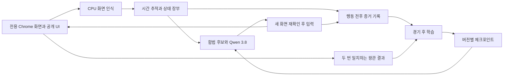
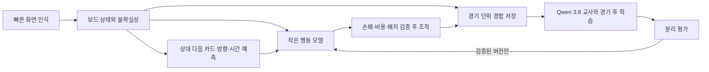

# 플레이 학습 요구사항과 구조

2026-11-15 대화에서 합의한 요구를 보존한다. 구현 상태는 아래 파일과 실행 기록으로 확인하며, 가중치 변경을 실력 향상으로 부르지 않는다.

## 스킬 낭비·무덤 수비·오두막 지출의 회귀 수정

2026-11-17 추가 확인: 2 엘릭서에서 대기와 스킬만 남으면 비슷한 확률의 추첨을 반복하다 결국 스킬을 썼다. 최근 8경기의 스킬 20회 중 5회는 인식된 적이 없었다. 바바리안 통도 위치 후보 여러 개의 확률을 합치면 대기 하나보다 유리해지는 편향이 있었다. controller 3은 카드별 위치 후보 수로 확률을 정규화하고, 관측된 스킬 기회가 없거나 통 경로에 적이 없는 선택에는 명시적인 비용을 더한다. 알려진 상대 고블린 통의 순환·추정 자원도 빈 통 지출의 비용에 반영한다. 합법 행동은 지우지 않는다. 이는 학습으로 알아낸 규칙이 아니라 공개한 사전 보정이다. 같은 보정이 실제 선택, 저장된 행동 확률, PPO와 모방학습에 적용되며 수읽기 보조 과제의 원시 확률과 구분된다.

`combat-projection.json`은 이동·등장 지연·피해 예측의 공유 기준이다. 같은 유닛을 두 번 이상 추적한 속도와 화면에서 읽은 체력 구간을 사용해 얼법 등장 피해, 통의 굴러가는 경로, 독 영역에 머무를 시간과 틱 피해, 처치 가능성 구간을 계산한다. 처음 본 유닛을 정지 상태로, 읽지 못한 체력을 최대 체력으로 채우지 않는다. `h`는 현재 접촉, `d`·`k`·`e`는 예측 피해·처치·체류 시간이다. 선택된 행동의 예측과 원본 화면 사실을 함께 기록한다. 수치는 레벨 11 참고값이며 Counterpush에 보정되지 않았다. 방향 전환·대상 변경·정확한 독 틱 경계·배지 중심과 발 위치의 오차가 남아 있어 실제 처치를 보장하지 않는다. 스킬의 `q`도 주변 전투 기회이며 둔화 표식과 동결 대상 자격을 확인한 값은 아니다.

controller 3의 얼법·통 후보는 배치 지연 뒤 적 위치와 통 이동을 비교한다. 수비가 급할 때 얼법 후보 5개 중 2개를 킹타워 뒤에 고정하던 할당은 없애고 대응 위치 4개와 후방 1개를 비교한다. 빈 필드의 빌드업에는 양쪽 킹타워 뒤와 아군 지원 위치를 유지한다. controller 1의 기존 위치 선택은 유지한다. Counterpush의 현재 미러 덱에는 고블린 통이 없으므로 실제 미끼 덱 대응이나 Android 트로피 자동 학습을 검증했다고 보고하지 않는다.

추가 실전 오배치를 재현해 오두막에 일반 유닛용 타워 앞 기본 좌표가 섞이는 경로를 제거했다. `predictive-placement.ts`는 후보의 카드별 배치를 소유하며 오두막의 유인·활성 범위, 기존 오두막과 독 위험을 격자에서 비교한다. 통은 근접 유닛용 옆 배치를 쓰지 않고 전진 경로를 고른다. 독은 움직이지 않는 건물이 미래에 영역 안으로 걸어 들어오는 것처럼 취급하던 오차 확대를 고쳤고, 가능한 이동의 피해 상한과 현재 궤적의 참고 피해(`n`)를 구분한다. 무덤도 아군 지원·관측된 수비와 독 위치를 비교한 타워 오프셋 후보를 사용한다. 상대 시연의 후보도 같은 생성기를 사용하고 AFTER 위치로 후보를 만들지 않는다.

선택 분포의 명시적 사전 보정은 빈 독, 중복 독, 저엘릭서의 이른 오두막과 기존 오두막 중첩, 지원 없이 상대 독·얼법·오두막이 돌아올 수 있는 무덤, 활성 무덤 수비 자원 유출, 킹타워를 깨울 위험을 비교한다. 상대 손패는 순환과 엘릭서 범위로 판단하며 정확한 패를 만들지 않는다. `towers`는 알려진 타워 체력 비율 또는 `?`다. 현재 실전에서 타워 체력·활성 상태를 읽지 않으므로 킹타워 위험을 보수적으로 적용한다. 시뮬레이션에서 왕 체력이 깎였거나 공주 타워가 파괴된 공개 상태라면 이 보정을 해제한다. 이것은 실전의 모든 타워 상태·마무리 피해를 정확히 읽었다거나 전략을 전부 학습했다는 뜻이 아니다.

2026-11-16 실제 controller 3 기록에서 무덤이 활성화된 라인과 다른 쪽에 독·통을 쓰고, 대기와 스킬만 남았을 때 스킬을 자주 선택하는 사례를 확인했다. 스킬을 자동 실행하는 별도 명령은 없었다. 하지만 짧은 판단 문자열에 스킬의 효과 조건과 무덤의 경과 시간이 전달되지 않았고, 반복 패배에서 이동 평균 기준값이 -1에 수렴해 패배의 정책 기울기가 거의 사라지고 있었다.

판단 문자열에는 무덤의 관측 경과 시간(`@2s`)과 알 수 없는 시작 시점(`@?s`), 스킬의 비용·순환 비발생·효과 조건, 오두막의 범위와 방어 자원 비교를 함께 전달한다. 이는 참고 수치이며 Counterpush 물리의 완전 일치를 뜻하지 않는다. 인식한 같은 유닛의 동일한 박스가 배지·체력 막대에서 두 번 선택되면 한 번만 센다. 연속 승패에도 결과 신호가 사라지지 않도록 과거 기준값을 계산에 사용할 때 [-0.5, 0.5]로 제한하고 실제 advantage 범위를 학습 보고서에 남긴다. 경기 전체 승패만으로 개별 배치의 원인을 분리해낸 것은 아니다.

자가대국과 빠른 실전 정책은 엘릭서 8 이상에서도 대기를 합법 후보로 유지한다. 전술 자료는 준비된 스킬·오두막이 있는 빈 필드, 저엘릭서에서 스킬과 대기만 가능한 필드를 추가한다. 모든 행동을 같은 공개 상태에서 12초씩 실행해 타워 체력과 실제 종료 엘릭서를 비교한다. 동일한 시간의 재생과 10 상한을 적용하며 명목 비용을 누적한 가상의 저축액을 쓰지 않는다. 체력 차이 35 이내에서 자원이 더 남는 등 다른 행동에 밀리는 선택은 자원 보존 라벨의 정답에서 제외한다. 타워 피해와 자원 사이의 교환비를 임의로 정하지 않고 유리한 선택들을 함께 남긴다.

이 자료는 미래 상대 배치가 없는 제한된 시뮬레이션 지도학습이다. 실제 상대의 다음 공격을 알아맞힌 증거, 실전 승리, 실전 100판 목표로 세지 않는다. 실전 모델 채택은 기존 별도 평가를 통과해야 한다.

시뮬레이션의 무덤 단계도 공개된 사용 기록의 시간·위치로 계산한다. 비공개 주문 타이머를 읽지 않고, 사용 기록이 없거나 같은 곳의 효과가 겹치면 모르는 값으로 둔다. 이 시간은 주문 사용 이후이며 실전 화면은 효과를 처음 관측한 이후이므로 관측 지연만큼 차이가 남는다.

## 패배한 미러전에서 직접 배우는 행동 정책

상대의 다음 카드·라인을 맞히는 보조 과제를 없애고 `counterpush-mirror-actor-demonstrations-v4`를 사용한다. 동일 덱 미러전에서 두 번 일치한 결과로 RED의 승리가 확인된 경기만 상대 교사로 삼는다. 원본 BEFORE의 유닛·효과를 강 기준으로 위아래 반사하고 진영을 바꿔 실전과 같은 BLUE 행동 선택 문자열로 학습한다. 관측되지 않은 교사의 손패는 `????`, 잔량은 추정 범위, 능력은 모르는 상태로 남긴다. BLUE의 실제 손패·다음 카드·정확한 잔량을 반사해 누출하지 않는다.

후보 위치와 순서는 BEFORE의 필드·그림만으로 만든다. AFTER 그림·확인한 행동은 정답 검증에만 쓴다. 독·무덤·오두막처럼 움직이지 않는 관측의 중심은 24~45px 오차 영역으로 표시하고, 그 영역에 들어가는 기존 후보들만 위치 정답으로 학습한다. 얼법·용광로·기사·해골은 전후 간격이 1.2초 이하인 새 관측에만 이동 속도에 따른 추가 오차 영역을 허용한다. 바바리안의 등장 위치를 통의 시전 좌표로 바꾸지 않는다. 후보가 영역을 덮지 못하거나 관찰 간격이 긴 이동 유닛은 카드·라인 수준임을 명시한다. 이것은 정확한 터치 좌표 복원이나 상대의 모든 행동이 좋은 수였다는 주장이 아니다. 평가 역할의 경기는 거부하고 입력 복구 경기는 제외한다. 모델이 본 모방 자료의 SHA-256과 재개 receipt를 맞춰 다른 자료의 성공 기록을 재사용하지 않는다. 기존 v3 자료는 읽지 않고 보존된 원본 증거를 다시 검증해 별도 v4 자료를 만든다.

실전 판단에는 상대의 추가 순환 횟수 범위도 전달한다. 모르는 값을 정확한 손패로 바꾸지 않는다. 얼법 등장 범위, 바바리안 통의 전진 경로·폭, 독 영역에 현재 관측된 적이 몇 기 들어가는지 `h`로 계산한다. 수치의 단일 기준은 `contracts/placement-effects.json`이며 기존 카드 지식도 같은 값을 읽는다. `h`는 현재 접촉 가능성으로, 미관측 유닛의 부재·공중 여부·미래 이동·독 8초 전부의 피해를 증명하지 않는다. 실제 피해·성공 여부는 별도 전투·실전 평가가 필요하다.

## 사용자 요구와 현재 적용

| 요구                                                                      | 적용과 검증 범위                                                                                                                                                                                                                                    |
| ------------------------------------------------------------------------- | --------------------------------------------------------------------------------------------------------------------------------------------------------------------------------------------------------------------------------------------------- |
| 폰 없이 Mac에서 실행하고 자원을 적게 쓴다                                 | Counterpush 전용 Chrome에서 실행하며 Android·에뮬레이터를 쓰지 않는다. Qwen 3.8은 약 16GiB를 쓰므로 저자원 목표를 완전히 달성한 것은 아니다.                                                                                                        |
| Qwen **3.8**로 실제 모델이 학습한다                                       | 고정 revision의 27B 4bit 모델과 마지막 MLP LoRA를 사용한다. 학습 전후 해시·버전·Adam 상태를 보존한다.                                                                                                                                               |
| Counterpush AI와 계속 대전한다                                            | `counterpush start --background --matches 0 --hours 8`. 전용 Chrome + Playwright와 로그인은 승인/완료됐다. 모델/인식기 각각 하나, 대화와 독립 실행 및 시간 제한을 지원한다. 실제 서비스가 다른 탭의 경기 시작 시 기존 경기를 닫으므로 한 탭만 연다. |
| 상대 행동을 자동 인식하고 배운다                                          | 화면의 적 표식 → 유닛/효과 분류 → 시간 추적 → 이전 화면에 없었는지 확인 → 행동 전 상태와 카드·방향을 묶어 모방학습한다. 누락되는 행동이 있고 정밀 배치·시간의 학습은 아직 아니다.                                                                   |
| **내 필드의 유닛 종류·위치·상황을 보고 상대가 언제 무엇을 내는지** 배운다 | 행동 이전 `BattleSituation`에 양쪽 유닛, 내 손패·최근 사용 카드·좌표, 엘릭서 범위와 순환 가설을 저장하고 상대 응답 예측 프롬프트에 넣는다. 행동 후 화면은 정답 검증에만 쓴다. 인과관계를 입증한 모델은 아직 아니다.                                 |
| 양쪽 엘릭서는 같은 속도로 충전된다                                        | 내 잔량 변화에 내 확인된 지출을 더해 공유 재생량을 추적하고, 상대의 확인된 지출을 뺀다. 인식이 불확실한 프레임과 입력 중의 빈 막대는 장부에 넣지 않는다.                                                                                            |
| 엘릭서는 **10 상한**, 넘친 충전량은 저장되지 않는다                       | 매 단계 잔량을 0~10으로 자른다. 내 상한에서 가려진 재생은 오차 범위로만 취급한다. 상대의 놓친 행동과 영웅 스킬 때문에 상대 잔량은 단일 숫자 대신 범위로 유지한다.                                                                                   |
| 덱 **8장**, 손패 **4장**, 대기 **4장 FIFO**                               | 카드를 쓰면 큐의 맨 앞을 뽑고 쓴 카드를 맨 뒤에 넣는다. 이후 4회 사용 전에는 돌아오지 않는다. 내 손패로 큐 가설을 좁히고 상대의 놓친 행동이 있으면 가설을 넓힌다. 회귀 검사가 있다.                                                                 |
| **8장 모두 중요**                                                         | 바바리안 통·용광로·고블린 오두막·무덤·영웅 얼음 마법사·진화 기사·독·해골 병사의 고정 덱이다. 카드별 발견/선별/실제 학습 건수를 따로 기록한다. 한 경기에서 카드당 최대 2사례를 선별해 무덤 편중을 제한한다. 이는 모든 카드가 학습됐다는 뜻이 아니다. |
| 카드 능력·스킬·진화·공격 범위와 승리 조건을 고려한다                      | 버전별 참고 수치, 관측한 일반/진화/히어로 구분, 기사·용광로 진화 횟수, 현재 덱의 히어로 얼음 마법사 스킬 입력과 별도 지출을 연결한다. 참고 수치의 Counterpush 전체 일치, 모든 챔피언 스킬·타이브레이크·전투 물리는 미검증/미구현이다.               |
| 하루 제한이 있는 복기를 쓰지 않는다                                       | 사이트의 복기 기능을 호출하지 않는다. `rescan`은 **로컬에 저장한 화면**만 다시 인식한다.                                                                                                                                                            |
| 소리를 끈다                                                               | 전용 봇 Chrome에만 `--mute-audio`를 적용한다.                                                                                                                                                                                                       |
| 트로피 손실은 괜찮다                                                      | 실제 클래시로얄 자동 조작을 지원하지 않으므로 해당하지 않는다. 업그레이드·구매·계정 설정은 플레이 범위에 포함하지 않는다.                                                                                                                           |
| 수정은 커밋하고 개선 여부를 사실대로 말한다                               | 코드·참조 자료를 작게 커밋한다. 로그인·원시 경기·모델·체크포인트는 `.data/`에 격리한다. 로컬 커밋과 push/PR을 구분한다.                                                                                                                             |

실제 클래시로얄 클라이언트의 자동 조작은 [Supercell 이용약관](https://supercell.com/en/terms-of-service/)이 봇·자동화 소프트웨어를 금지하므로 지원하지 않는다. Counterpush의 결과를 실제 게임 성능으로 해석하지 않는다.

## 실제 서비스의 동시 실행 제한

2026-11-15 실전 확인: 두 탭이 시작한 경기의 결과와 공동 PPO 갱신은 확인했지만, 재매칭 시 사이트가 “This match closed: a game was started in another tab or window.”라고 명시했다. 처음 재매칭 UI 오류로 판단했던 것은 이 화면을 보고 정정한다. 현재 Counterpush 실행은 한 탭만 허용하고, 종료된 미확인 경기는 보상이나 모방 자료로 학습하지 않는다. v54까지의 확인된 학습을 보존해 한 탭에서 계속한다. 실행기는 한 탭만 연다.

한 탭 재시작도 별도로 확인한다. 결과 화면을 새로고침하면 결과 창이 보존돼 준비 화면의 `#battle` 버튼은 숨겨진 상태였다. 이 임시 복구 경로는 제거하고, 실제 결과 화면에 보이는 `Play again` (`#again`)을 사용한다. 진행 중인 경기에서는 재시작하지 않는다. `match_start.initialPhase`로 준비/결과 중 어느 화면에서 시작했는지 기록한다.

## 현재 데이터 흐름과 소유자

추가 사용자 요구: 빈 필드에서 모든 유닛을 타워 뒤로 고정하지 않는다. 생성형 건물·생성형 유닛과 그 자식 유닛의 상호작용, 이동 속도·사거리·공격/배치 지연을 고려한다. 무덤 수비는 고정된 해골 생성 순서와 경과 시간을 다룬다. 이 요구를 단순한 카드 사용 횟수로 충족했다고 보고하지 않는다.

- `browser.ts`가 자기 전용 브라우저의 수명·드래그·공개 결과를 소유한다. 게임 엔진 내부 상태나 비공개 API를 읽지 않는다.
- `vision_worker.py`는 고정된 CPU 분류기와 화면 참조를 소유한다. 이동 중인 같은 유닛을 새 카드로 세지 않는다. 독/무덤의 효과와 실제 침입 유닛을 구별한다. 시각 점수는 통계적으로 보정된 확률이 아니다.
- `tracker.ts`가 유닛의 최초 위치와 시간 연속성을, `battle-state.ts`가 손패·FIFO 가설·지출 장부를 소유한다. 과거 스냅샷은 이후 행동으로 바뀌지 않는다.
- `episode.ts`는 경기 단위로 입력과 상대 사례를 연결한다. 손패 교체·비용과 맞는 지출·애니메이션 종료를 확인한다. 오래된 Qwen 판단과 세 번 연속 확인되지 않은 입력은 거부한다.
- 학습기는 한 프로세스에 모델을 유지한다. **같은 정책 버전의 내 행동 PPO를 먼저**, 그다음 상대 사례 모방학습을 실행한다. 체크포인트 쓰기는 단일 잠금으로 보호하며 다음 경기가 갱신된 버전을 사용한다.
- Counterpush 계정은 다른 탭의 경기가 시작되면 기존 경기를 닫으므로 실행기는 한 탭만 연다. 동시 대전이 가능해지면 경기별 정책 고정·공동 PPO·부분 중복 거부를 새로 설계해 실제 경기로 검증한다.
- 경기별 캡처·필드 추적·손패·지출·스킬 상태와 파일 경로는 경기 폴더가 소유한다. 오래된 화면을 추론 큐에 쌓지 않으며 추론 대기 중에도 상대 행동을 계속 인식한다. CPU 인식기의 요청/응답과 상태 파일 쓰기는 순서대로 처리하며 무덤 패턴은 단일 소유자가 저장한다.
- `audit.ts`는 내 확인된 사용, 상대 발견, 선별 자료, 실제 학습을 별도 집계한다. 빈 항목은 0으로 남긴다. 승패와 `improvement: unproven`을 함께 보고한다.

경기 원본은 `.data/counterpush/runs/<시각>/`, 모델 입력 자료는 `datasets/`, 실행 상태와 경기 목록은 `control/`에 둔다. 재인식은 `reprocessed-observations.json`을 만들며 원본을 덮어쓰지 않는다. 기존에 관찰한 같은 시간대의 행동은 재인식에서 제외한다. 새로운 데이터셋 해시만으로 의미상 중복이 완전히 제거되는 것은 아니므로 향후 안정된 이벤트 ID가 필요하다.

## 지금 구조가 비효율적인 이유

2026-11-15 추가 적용:

- 타워 뒤 2점만 주던 일반 유닛 후보를 후방 안쪽·중앙·전진·아군 지원·접근 적 대응으로 바꿨다. 타워와 영웅 UI 영역을 피하며 Counterpush 보정은 `profiles/counterpush.json`이 소유한다. 한 손패의 후보는 26개 이하여야 한다. 아직 모든 합법 타일을 직접 출력하는 자유 좌표 정책은 아니다.
- `src/core/knowledge.ts`에 레벨 11의 사거리·공격 주기·배치/첫 타격 지연·이동 분류·스폰 주기와 진화/영웅 조건을 출처와 함께 기록했다. 2026-11-14 현재 수치 자료와 Supercell 변경 공지를 대조했다. Counterpush와 모든 수치가 일치한다고 검증한 것은 아니다. 이동 수치 60/90/120을 타일/초로 잘못 사용하지 않는다.
- `FieldDynamics`가 양쪽 본체와 파이어 스피릿·창 고블린을 별개로 추적하고 화면상 속도를 추정한다. 자식 유닛은 새 카드 지출이나 FIFO 이동을 만들지 않는다. 부모가 여러 개면 정확한 부모를 꾸며내지 않는다. 관측된 자식 트랙 수는 실제 총 생성 수나 확정된 쿨다운이 아니다. 진화/영웅은 실제 분류가 뒷받침할 때만 표시한다.
- 무덤은 새 묘비 개수 대신 활성 영역을 추적한다. 수비 후보는 현재 해골/반복 관측에서 얻은 예측, 사거리, 얼음 마법사의 **이미 존재하는 해골에 대한 배치 피해**, 독 위험을 고려해 격자에서 고른다. 바바리안 통 한 번이나 단일 근접 유닛이 전체 무덤을 지운다고 가정하지 않는다.
- `SpawnPatterns`는 경과 시간과 상대 오프셋을 독립된 시전마다 모은다. 3개 이상의 시전에서 반복 관측돼야 미래 등장 후보를 제공한다. 첫 확실한 시각 인식 시점은 실제 생성 시점과 다르므로 이를 구분한다. 공격/수비 방향을 검증 없이 합치지 않고 짧은 관찰·이미 진행 중이던 효과·관찰 공백·겹친 시전은 정확한 패턴 근거로 쓰지 않는다. 아직 충분한 실제 패턴을 배웠다는 주장은 하지 않는다.
- 원본 `states.jsonl`은 유지하고 Qwen에는 표 형태로 압축한 상태를 전달한다. 상대 카드·방향 모방 후보와 내 실제 위치 후보를 분리해 위치 확장이 상대 학습의 토큰 한도를 넘기지 않도록 했다. 판단 중 새 무덤이 나타나면 이전 상황에서 고른 행동을 버리고 다시 판단한다.

정확한 충돌/경로·타워 체력·타깃 재선정·모든 스킬 효과를 재현하는 전투 시뮬레이터는 아니다. 피해량과 무덤 수비 성공을 직접 측정하기 전에는 학습 완료나 성능 향상을 선언하지 않는다.

### 히어로·챔피언·진화 추가 반영

- 양쪽 덱의 공개 카드 그림에서 `Furnace?form=evo`, `Knight?form=evo`, `IceWizard?form=hero`까지 검사한다. 기본 카드 8장만 같고 진화/히어로 구성이 다르면 시작하지 않는다.
- `EvolutionCycles`는 기사와 용광로를 각각 추적한다. 같은 카드를 일반 형태로 2회 낸 뒤 다음 진화, 진화 사용 후 재충전이라는 참고 규칙이다. 다른 카드 사용·능력 사용·자식 생성은 진화를 충전하지 않는다. FIFO와 별개다. 확인되지 않은 내 입력은 횟수 가설을 넓히고, 상대는 놓친 행동이 있으므로 처음부터 범위로 둔다. `counterExact`는 입력 장부의 확정 여부이며 **Counterpush 엔진 주기 검증**이 아니다(`engineCycleVerified: false`). 필드의 실제 진화형 인식과 다음 소환 형태의 예상은 구별한다.
- `HeroAbilityButton`은 현재 덱의 얼음 마법사 스킬 버튼 색·그림을 비교한다. 확인된 새 얼음 마법사 소환마다 별도 instance를 부여한다. 화면에서 버튼이 사라졌다고 사망이나 스킬 사용을 단정하지 않는다. 현재 스킬 대상은 가장 최근 소환이며 오래된 생존 개체가 능력을 넘겨받는다고 가정하지 않는다.
- Qwen에 **카드 배치 / 스킬 / 대기**를 구분해 준다. 스킬은 손패 밖에서도 사용할 수 있는 2 엘릭서 행동이다. 사용 직전 같은 instance의 버튼·신선한 화면·현재 비용을 다시 확인한다. 클릭 후 버튼 변화, 비용과 맞는 양수 지출, 손패 유지가 함께 확인돼야 성공과 학습 근거로 삼는다. 스킬은 엘릭서 장부에만 반영하고 카드 FIFO·진화 횟수·일반 카드 사용 통계를 바꾸지 않는다.
- 확인한 스킬 선택도 같은 행동 정책 버전의 PPO 후보로 들어간다. Python 학습기의 명시적 스킬 확인 경로와 실제 경기 자료를 읽는 경로를 검사한다. 이는 최적의 사용 시점·수비 효과·승률이 학습됐다는 증거가 아니다. `summary.json`과 `audit`에 스킬 시도/확인 수를 따로 기록한다.
- 상대 스킬 버튼과 정확한 사용 시점은 인식하지 않으므로 **사용 여부 불명**으로 유지한다. 상대 카드·방향 모방학습을 상대 스킬 타이밍 학습이라고 보고하지 않는다. 다른 히어로/챔피언별 버튼·효과 조작기는 아직 없다.
- [2026년 8월 공식 변경](https://supercell.com/en/games/clashroyale/blog/news/final-august-balance-changes-826/)의 기본 규칙은 소환당 1회이고 보스 도적은 예외다. [2025년 10월 순환 개편](https://supercell.com/en/games/clashroyale/blog/release-notes/october-update-2025/) 뒤 챔피언도 보통 카드와 같이 순환한다. 과거의 생존 중 덱 이탈·3장 순환을 적용하지 않는다. [현재 챔피언 안내](https://support.clashroyale.com/hc/en-us/articles/49484915467291-Champions)에서 같은 종류의 가장 최근 소환만 능력을 쓴다는 점을 재확인했다. 얼음 마법사의 2 엘릭서·둔화 대상 동결은 [공식 히어로 소개](https://support.clashroyale.com/hc/en-us/articles/54836231287963-What-s-New-September-2026)를 따른다.

1. **정답 품질이 먼저다.** 작은 레벨 표식 누락, 애니메이션을 0 엘릭서로 읽는 현상, 기존 유닛의 재등장은 잘못된 학습으로 이어진다. 데이터가 적을 때에는 모델을 크게 만드는 것보다 이를 고치는 편이 우선이다.
2. Qwen의 판단에는 초기 실측 약 1~2초와 캡처·입력 시간이 든다. 게임의 빠른 수비 반응마다 큰 시각 모델을 실행하는 구조에는 한계가 있다. CPU 인식은 Qwen 판단 대기 중에도 계속되지만 행동 결정 자체는 느리다.
   카드 물리·스킬 정보를 확장한 초기 실전에서는 프롬프트 평균 약 8.6~9.0천 자, 추론 약 6.2초로 느려졌고 일부 판단이 8초 신선도 제한에 걸렸다. 전체 수치/원본 상태는 보존하면서 모델에는 중복 없는 유닛 수치 표·진화 범위·행동 표를 보내도록 줄였다. 동일 저장 장면 4개의 입력은 8,663~9,859자에서 5,402~7,069자로 감소했다. 이는 입력 크기 측정이며 새 실전 추론 속도와 승률 향상은 별도로 확인한다.
3. 상대의 카드·방향을 맞히는 학습과 **내가 이기는 행동을 고르는 학습은 다르다**. 현재는 같은 어댑터가 두 작업을 배우므로 목표가 간섭할 수 있다. 상대 행동을 관찰했다고 그 행동이 최선이라고 가정해서는 안 된다.
4. 왕관 최종 결과만으로는 어느 수비·배치가 좋았는지 알기 어렵다. 현재 PPO의 보상은 희소하며, 계속 패배하는 데이터만 쌓인다고 좋아지는 것은 아니다.
5. 학습한 장면의 정답 확률이 오른 것은 학습 동작 확인이다. 초기 화면 학습에는 분리 평가와 새 버전 채택 기준이 없었다. 2026-11-16에 로컬 리그 채택 기준과 실전 고정 모델 A/B를 추가했으며, 충분한 실전 표본으로 승률이 개선됐다는 결과는 아직 없다.

## 권장 구조: 상태 추적 + 상대 예측 + 빠른 행동 모델

2026-11-16: 아래 제안 중 **로컬 정책·가치 모델, 정보 집합 수읽기, 자가대국, 기준 모델 비교, Qwen 후보 지도학습과 실전 고정 모델 A/B**를 추가했다. 현재 구현과 실행·검증 범위는 [자가대국 구현 문서](arena-learning.md)에 기록한다. 작은 모델의 실제 화면 조작은 controller 4(`counterpush play`)로 연결했다. 판단 문맥만으로 학습한 자가대국 정책이 1ms 안쪽에 판단하지만 실전 성능은 아직 검증하지 않았다. 별도 상대 예측기는 여전히 미구현이다.

추가로 실전 PPO·상대 모방도 별도 Qwen 후보에만 적용하고, 최소 32판의 Counterpush 비교와 원본 증거 재검사를 통과해야 적용 모델이 교체되도록 연결했다. 평가 중에는 두 모델을 고정하며 중단 시 같은 체크포인트·평가 기록으로 재개한다. 아직 운영 실전에서 충분한 우위를 확인해 새 모델을 채택한 결과는 없다.

아래는 설계 제안의 배경이다. 작은 모델은 로컬 탐색에 쓰며 실제 화면 조작은 Qwen이 담당한다. 상대 전용 예측기는 아직 배포되지 않았다.

**1. 상대 예측기를 별도 목표로 학습한다.** 입력은 행동 전 보드·최근 몇 초의 이벤트·상대 잔량 범위·순환 가설이고, 정답은 상대 카드/방향/발생 시간 구간이다. 내 기사·얼음 마법사·오두막 등이 언제 어디에 있었는지를 보존한다. 먼저 카드 빈도만 쓰는 기준 모델과 비교해 보지 않은 경기에서 NLL·top-k·방향·시간 오차를 잰다. 반응을 관찰한 자료만으로 특정 행동이 원인이었다고 단정하지 않는다.

**2. 조작은 작은 모델, Qwen 3.8은 교사로 둔다.** 작은 모델이 구조화한 필드와 상대 예측을 받아 후보 중 행동을 고르고, Qwen은 애매한 장면과 경기 후 판단 자료 생성에 쓴다. Qwen 판단도 검증할 대상이며 정답 오라클이 아니다. 목표 반응 시간은 예를 들어 200ms이지만 실제 Mac에서 측정하기 전에는 성능으로 보고하지 않는다. 사용자 선택인 Qwen 3.8을 유지하면서 매 프레임의 큰 모델 호출과 메모리 점유 시간을 줄이는 방향이다.

**3. 경험은 상황별로 균형 있게 저장한다.** 카드·라인·위험도·내 필드 조합·엘릭서 구간·순환·버전으로 조회한다. 빈번한 무덤 장면만 추가하지 말고 부족한 카드, 실패한 수비, 불확실한 인식을 우선 확인한다. JSONL을 원본 증거로 두고 필요해지면 SQLite에 이벤트/관찰/행동/결과/버전을 색인한다. 지금은 구조가 정해진 필터가 중심이므로 벡터 DB 추가가 우선은 아니다. 이미지 유사 상황 검색을 실제로 도입할 때 임베딩 색인을 검토한다.

**4. 학습과 채택을 구분한다.** 경기를 통째로 학습/평가로 나눈다. 같은 추적 유닛의 이웃 프레임이 양쪽에 섞이지 않도록 한다. 상대 예측 정확도, 내 입력 성공률, 카드별 자료 범위, 같은 덱/난이도의 승률·왕관 차이·타워 피해를 별도 기록한다. 새 모델과 기준 모델을 번갈아 대전시켜 표본 수와 불확실성까지 보고하고, 악화한 버전은 보존한 이전 모델로 돌아간다. 실제 타워 체력 인식이 검증되기 전에는 피해량 보상을 만들지 않는다.

**5. 버전 계약을 지킨 채 비동기화한다.** 한 경기 동안 행동 모델은 고정한다. Qwen 특징은 그 특징을 만든 어댑터 버전과 묶는다. 오래된 정책의 기록을 현재 PPO에 그대로 재사용하지 않는다. 상대 예측기의 지도학습 자료는 재사용할 수 있지만 행동 정책의 데이터와 다른 경로다. Mac 한 대에서는 분산 시스템을 도입할 필요 없이 별도 작업 큐와 경기 사이의 모델 교체로 시작한다.

## 완료 판단

2026-11-15 자료 감사에서 이미 활성화된 무덤에 새 묘비가 보이는 것을 새 카드로 받은 오류를 확인했다. 과거 무덤 관찰 15건 중 14건은 행동 전 화면에 큰 보라색 효과가 있어 격리했고, 별도의 얼음 마법사 1건도 이전 화면의 정체가 모호해 격리했다. 새 묘비의 부재만 확인하던 방식을 바꾸고 **행동 전 라인의 무덤 효과**가 남아 있으면 학습하지 않는다. 격리 목록은 `.data/counterpush/quarantine.json`이며 자료 준비와 실제 Python 학습 양쪽에서 검사한다. 원시 화면과 이전 체크포인트는 삭제하지 않았다.

그 자료가 섞인 v8~v34 계열을 계속 이어가지 않고, 마지막으로 시각 검증했던 v7을 새 번호 v35로 복구했다. 화면을 다시 확인한 오두막·바바리안 통·독·해골 병사 4건만 재학습해 v36을 저장했다. 이는 자료 품질 복구이며 승률 향상 증거가 아니다. 이전 엘릭서 보정 복구 기록도 별도로 남아 있다. 자료 감사·복구·실제 모델 갱신의 상세 기록은 `.data/counterpush/control/label-recovery.json`과 `audited-recovery-20261115/`에 보존한다.

또한 결과 라벨의 `, overtime` 접미사 때문에 연장전 종료를 인식하지 못한 사례를 고쳤다. 두 번 일치하는 왕관 수와 제한된 접미사만 인정한다. 대전/결과 화면이 45초 동안 확인되지 않으면 화면 대기 상태와 오류를 기록하고 멈추며, 알 수 없는 결과를 보상으로 만들지 않는다.

- 기본 규칙은 FIFO·비용·10 상한·미래 정보 누출 회귀 검사로 확인한다.
- 8장별 상대 발견/학습 건수를 제시하고 0건을 숨기지 않는다. 근거 없는 카드 사례를 채워 넣지 않는다.
- 입력 성공, 실제 어댑터 갱신·재적용, 이어지는 대전을 각각 확인한다.
- **승률이나 보지 않은 상황의 판단이 검증되기 전에는 ‘실력이 개선됐다’고 보고하지 않는다.**

## 설계 참고

[Supercell 2026년 1월 공지](https://supercell.com/en/games/clashroyale/blog/release-notes/january-balance-changes-26/)는 무덤의 무작위 생성을 고정 순서로 바꿨고, [2월 공지](https://supercell.com/en/games/clashroyale/blog/news/february-balance-changes-26/)는 생성 위치를 다시 조정했다. [6월 공지](https://supercell.com/en/games/clashroyale/blog/release-notes/june-balance-changes-2026/)에서 무덤은 12마리, 용광로 사거리는 5.5타일로 바뀌었다. 이전 패턴 도표를 최신 게임에 그대로 대입하지 않는다.

현재 레벨 11 참고 수치: [용광로](https://www.royaletools.com/cards/furnace), [얼음 마법사](https://www.royaletools.com/cards/ice-wizard), [기사](https://www.royaletools.com/cards/knight), [해골](https://www.royaletools.com/cards/skeletons), [오두막](https://www.royaletools.com/cards/goblin-hut), [무덤](https://www.royaletools.com/cards/graveyard), [독](https://www.royaletools.com/cards/poison), [바바리안 통](https://www.royaletools.com/cards/barbarian-barrel). 이는 제3자 게임 수치 자료이며 Counterpush의 실측으로 표시하지 않는다. 용광로 페이지의 오래된 건물 분류 문구 대신 Supercell의 [이동 유닛 개편 공지](https://supercell.com/en/games/clashroyale/blog/release-notes/new-season-fired-up/)를 따른다.

[Ross와 Bagnell의 모방학습 연구](https://proceedings.mlr.press/v9/ross10a.html)는 학습한 정책이 이후 만나게 될 상태를 바꾸므로 고정 자료 모방의 오류가 누적될 수 있음을 다룬다. 자신의 실제 플레이에서 생긴 상황을 수집·평가해야 한다는 설계 근거이며, 여기서 논문의 알고리즘을 구현했다는 뜻은 아니다.

[IMPALA](https://proceedings.mlr.press/v80/espeholt18a.html)는 행동과 학습을 분리하되 정책 차이를 보정하는 구조를 제시한다. 이 프로젝트에서는 분리와 버전 관리의 참고로만 삼고, 분산 처리나 V-trace를 구현했다고 주장하지 않는다. 위의 작은 모델 전환은 현재 코드의 지연·자료 부족을 고려한 설계 제안이며 효과는 미측정이다.

실전 controller 3도 Qwen 추론을 기다리는 동안 필드를 계속 관측해 상대의 짧은 배치를 놓치는 간격을 줄인다. 예측이 끝나면 350ms 대기 주기가 남아 있어도 바로 깨어난다. 인식은 관측만 갱신하고 모델이 고른 행동을 덮어쓰지 않으며, 1초 초과 판단의 입력 차단은 유지한다.

피해 범위·무덤 단계·능력·오두막 조건의 고정 설명은 매 판단에서 생략하지 않고 공통 머리말에 둔다. Qwen은 이 고정 구간과 현재 필드·후보 구간을 나눠 실행하고 고정 구간의 상태만 재사용한다. 학습 자료와 실시간 판단은 같은 계산 경로를 쓰며, 이전 일괄 실행과의 수치 차이·캐시 상한·실측은 [1초 판단](fast-training.md)에 기록한다.
